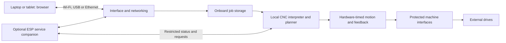
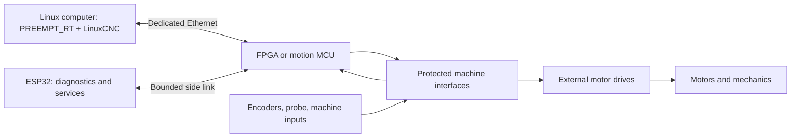
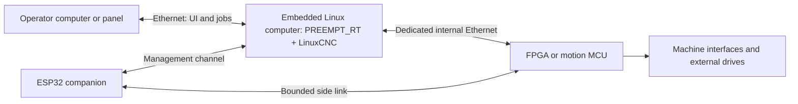

# Building a modern standalone CNC controller: motion, connectivity, and 2022–2026 technology

**Historical research, scope reviewed 18 October 2026.** The 27 September investigation below retains its original sources and recommendations. Current product decisions are in [the briefing](PROJECT_BRIEFING.md), [IS-2](docs/MOTHERBOARD_IS2.md) and [engineering status](reports/ENGINEERING_STATUS.md). The adopted direction is local LinuxCNC with a soldered FPGA on one active twelve-interface motherboard and replaceable purchased compute/ESP/storage modules. The MCU-main-controller alternatives, earlier six/two studies and quoted market observations below are historical; this review does not reverify external prices, specifications or availability. [Documentation index](docs/README.md)

Research date: 27 September 2026. This is an architectural investigation, not a completed electrical design or a validated motion-control implementation. Manufacturer facts below are linked to primary documentation. Proposed layouts, priorities, and development steps are engineering recommendations.

The working brief is to build a custom controller inspired by Mesa and Acorn, learn from Octopus Pro and FluidNC, and use modern onboard computing with Ethernet, USB-C, and wireless connectivity. The operator should be able to use an ordinary workstation laptop or browser. An ESP-family chip could be the main CNC processor or a companion. The desired real-time control does not require Linux on the operator's laptop; Linux inside the controller is one option, and autonomous MCU firmware is another.

**The original recommendation was an autonomous controller: upload jobs to the controller, interpret and plan them locally, generate motion locally, and expose a browser interface.** The local-execution principle still holds; the MCU-firmware main-controller variant of it has since been superseded (see the supersession note below). USB-C, Wi-Fi, Bluetooth, and Ethernet can serve appropriate interface roles while local hardware meets motion deadlines. Evaluate established CNC software on supported targets. The expanded advanced-machine and model-based setup requirements make embedded LinuxCNC plus dedicated motion hardware a leading branch to investigate alongside MCU implementations. New ESP32-S31 and P4 hardware are promising firmware-development platforms, not verified drop-in FluidNC replacements.

**Engineering update:** the user wants to preserve their existing Octopus/MR-1 interface and make machine, plate and vise model setup approachable without coding or CAD expertise. See the [product experience specification](docs/PRODUCT_EXPERIENCE.md) and [workspace index](README.md). The subsequent [pinned firmware audit](research/FIRMWARE_FEASIBILITY.md) includes an actual native grblHAL build and motion simulation, as well as unresolved validator timeouts. It also establishes current FluidNC native/WASM and RP2040/RP2350 target declarations; those builds have not been verified here. The audit supersedes broader firmware assumptions in this initial research note.

**Supersession note (28 September 2026):** [ADR-020](docs/ARCHITECTURE_DECISIONS.md) and the [build plan](docs/BUILD_PLAN.md) later selected local PREEMPT_RT Linux/LinuxCNC execution inside the controller, a custom FPGA for pulse generation, feedback capture and I/O/watchdog behavior, and an ESP-IDF service helper. That decision replaces the earlier H7/grblHAL (autonomous MCU firmware) main-controller proposal that this note treated as the first development baseline. Read the MCU-first statements below as the original 27 September research position, not the current working baseline.

## Relevant technology news from the last four years

The date window is 27 September 2022 through 27 September 2026. The table distinguishes specifications, announcements, production milestones, and existing CNC support. Relevance judgments are engineering interpretations.

| Date | Verified development | What it offers this controller |
|---|---|---|
| 18 Oct 2022 | USB4 v2.0 specification published: 80 Gbps, with optional asymmetric 120/40 Gbps operation | High-bandwidth cameras, storage, displays and docking; a USB-C connector alone does not implement these speeds |
| 5 Jan 2023; updated 8 May 2026 | ESP32-P4 announced; v3.x upgrade later qualified 400 MHz operation and revised hardware/firmware requirements | More onboard processing, screen/camera interfaces and networking peripherals; external radio companion required |
| 15 May 2023; follow-up 7 Mar 2024 | STM32MP2 introduced; 2024 release described the A35/M33 platform and scheduled production | Application/Linux processing and a dedicated real-time core within one processor family |
| 28 Sep 2023; 27 Nov 2024 | Raspberry Pi 5, followed by Compute Module 5 | A compact embedded Linux computer for a custom carrier, local storage, browser services and advanced control software |
| 8 Jan 2024 | Wi-Fi CERTIFIED 7 launched, including Multi-Link Operation | Multiple Wi-Fi links can improve communication throughput/reliability; requires compatible endpoints |
| 8 Aug 2024; 17 Mar 2025 | RP2350/Pico 2 launched; bare-chip general availability followed | Affordable MCU with FPU and 12 programmable-I/O state machines; current upstream grblHAL support exists |
| 17 Nov 2024 | Linux 6.12 released with mainline PREEMPT_RT support | Real-time Linux integration improved; board/kernel/application timing still needs validation |
| 30 Apr 2025 | ESP32-C5 entered mass production | 2.4/5 GHz Wi-Fi 6 and Bluetooth LE in a useful network-companion chip |
| 4 Nov 2025 | Bluetooth 6.2 announced with Shorter Connection Intervals | Potentially more responsive pendants and sensors; the 375 microsecond minimum is not guaranteed application latency |
| 19 Jun 2026 | Wi-Fi Alliance and Bluetooth SIG announced joint coexistence work | Better spectrum coexistence is being developed; this is not a completed Wi-Fi-plus-Bluetooth bandwidth-bonding standard |
| 27 Jul 2026 | ESP32-S31 entered mass production | 320 MHz-class RISC-V processing, 2.4 GHz Wi-Fi 6, Bluetooth including Classic, Gigabit Ethernet MAC, high-speed USB and substantial I/O |
| 28 Jul 2026 | Bluetooth SIG described upcoming High Data Throughput up to 7.5 Mbps | A future capability to watch: still draft, with adoption anticipated in late 2026 as of the research date |

Primary announcements: [USB-IF USB4 v2.0](https://usb.org/sites/default/files/2022-10/USB-IF%20USB%2080Gbps%20Announcement_FINAL_v2.pdf), [P4 introduction](https://www.espressif.com/en/news/ESP32-P4), [P4 v3.x update](https://www.espressif.com/en/news/ESP32_P4_v3.x_Upgrade), [STM32MP2 introduction](https://newsroom.st.com/media-center/press-item.html/p4546.html), [STM32MP2 2024 release](https://newsroom.st.com/media-center/press-item.html/p4612.html), [Pi 5](https://www.raspberrypi.com/news/introducing-raspberry-pi-5/), [CM5](https://www.raspberrypi.com/news/compute-module-5-on-sale-now/), [Wi-Fi Alliance release](https://www.globenewswire.com/news-release/2024/01/08/2805409/0/en/Wi-Fi-Alliance-introduces-Wi-Fi-CERTIFIED-7.html), [Pico 2/RP2350](https://www.raspberrypi.com/news/raspberry-pi-pico-2-our-new-5-microcontroller-board-on-sale-now/), [RP2350 chip availability](https://www.raspberrypi.com/news/rp2350-now-available-to-buy-a-high-performance-secure-microcontroller-for-your-next-project/).

Additional primary announcements: [Linux release dates](https://kernel.org/category/releases.html) and [PREEMPT_RT mainline status](https://wiki.linuxfoundation.org/realtime/preempt_rt_versions), [C5 production](https://www.espressif.com/en/news/ESP32-C5_Mass_Production), [Bluetooth 6.2](https://www.bluetooth.com/blog/just-released-bluetooth-core-6-2/), [joint coexistence work](https://www.bluetooth.com/press/wi-fi-alliance-and-bluetooth-sig-initiate-joint-work-to-advance-coexistence/), [S31 production](https://www.espressif.com/en/news/ESP32_S31_Mass_Production), [Bluetooth HDT](https://www.bluetooth.com/blog/bluetooth-le-will-soon-get-a-major-boost-in-speed-introducing-bluetooth-high-data-throughput-hdt/).

### The most interesting processor choices

**ESP32-S31 is the newest integrated ESP candidate worth investigating.** Its production announcement lists up to 320 MHz, 512 KB SRAM, expandable PSRAM, and up to 60 GPIO alongside its radios and Ethernet MAC. Ethernet still requires the relevant physical-interface circuitry. Its FAQ describes evolving ESP-IDF support; available silicon does not establish mature CNC support. [S31 production](https://www.espressif.com/en/news/ESP32_S31_Mass_Production), [S31 FAQ](https://esp32-s31.espressif.com/en/faq)

**P4 plus C5/C6 embodies the main-processor-and-helper idea.** The P4 can host substantial application/control software and a local screen; a companion handles radio connectivity through ESP-Hosted. P4 has no native Wi-Fi/Bluetooth. Current FluidNC build targets were inspected: P4, C5 and S31 were not established as supported targets. A CNC port and qualification would be intentional work. [P4 product](https://www.espressif.com/en/products/socs/esp32-p4), [ESP-Hosted](https://github.com/espressif/esp-hosted-mcu), [FluidNC targets](https://github.com/bdring/FluidNC/blob/main/platformio.ini)

**RP2350 plus an ESP is a particularly useful prototype candidate.** PIO state machines can perform accurately timed I/O without requiring the main CPU to service every individual edge. This is more limited than a general FPGA, but potentially sufficient for the chosen pulse/encoder functions. Its current grblHAL driver explicitly supports RP2350/Pico 2. Exact board maps, pin resources, networking integration and machining features still determine suitability. [RP2350 product](https://www.raspberrypi.com/products/rp2350/), [grblHAL RP2040/RP2350 driver](https://github.com/grblHAL/RP2040)

**CM5 is the practical embedded-Linux candidate; STM32MP2 is an ambitious integrated alternative.** LinuxCNC publishes a Pi 4/5 image, but that does not validate a particular CM5 carrier. STM32MP2 combines Linux-capable A35 processing and an M33 core; no ready CNC software combination was verified here. For either, the remote laptop could run Windows or macOS while Linux stays inside the controller. [CM5 announcement](https://www.raspberrypi.com/news/compute-module-5-on-sale-now/), [LinuxCNC downloads](https://linuxcnc.org/downloads/), [STM32MP2 announcement](https://newsroom.st.com/media-center/press-item.html/p4612.html)

### What USB-C and multiple radios actually change

USB-C describes a connector system; USB 2.0, USB 3.x and USB4 specify different data capabilities. A USB-C connection is a useful product choice even if its MCU implements only USB 2.0. Select a data-capable implementation, with deliberate power and recovery behavior. USB4's headline bandwidth is unnecessary for ordinary G-code, but can matter for camera and storage workloads. [USB-IF terminology](https://www.usb.org/sites/default/files/usb4_language_product_and_packaging_guidelines_final__0.pdf)

Wi-Fi and Bluetooth can have complementary jobs: Wi-Fi for UI/files/video, Bluetooth for discovery, provisioning, pendants, and low-power sensors. They do not normally add their bit rates into one connection. The classic ESP32 shares one 2.4 GHz radio between them using time division. Dual-band C5 support likewise should not be confused with Wi-Fi 7 MLO. [Espressif coexistence](https://docs.espressif.com/projects/esp-idf/en/stable/esp32/api-guides/coexist.html), [C5 documentation](https://documentation.espressif.com/esp32-c5_datasheet_en.html)

Bluetooth developments should be matched to actual endpoints: 6.0 introduced Channel Sounding; 6.2's shorter intervals are a separate responsiveness feature; the 2026 HDT announcement describes a future speed feature. A Bluetooth 5.4 ESP does not acquire those features merely through a faster host CPU. [Bluetooth 6.0](https://www.bluetooth.com/blog/now-available-new-version-of-the-bluetooth-core-specification/), [6.2 feature details](https://www.bluetooth.com/bluetooth-core-6-2-feature-overview/), [HDT announcement](https://www.bluetooth.com/blog/bluetooth-le-will-soon-get-a-major-boost-in-speed-introducing-bluetooth-high-data-throughput-hdt/)

An illustrative stream of 1,000 lines/s at 80 bytes/line is 80 kB/s, or 0.64 Mbit/s before protocol overhead. That is a calculation, not a benchmark or maximum expected workload. It shows why local planning, sound buffering and defined disconnect behavior often matter more than increasing link speed. Uploading the complete job before running can remove ongoing file-streaming dependence entirely.

## Autonomous firmware: a practical starting point

| Candidate | Established capability | Work still required |
|---|---|---|
| ESP32-S3 + FluidNC | Local CNC firmware, WebUI, configuration and local-file workflows | Check the exact machining feature set and build suitable field electronics |
| RP2350, iMXRT1062, or supported STM32H7 + grblHAL | Local CNC execution with networking, WebUI and storage plugins on compatible configurations | Board/peripheral integration; audit feature maturity and sender behavior |
| Embedded LinuxCNC + timing hardware | LinuxCNC motion/kinematics/HAL ecosystem inside the enclosure | Browser service, embedded platform qualification, and timing hardware integration |
| S31 or P4-based custom firmware | Recent capable hardware and vendor SDKs | CNC port/implementation and substantial testing |

FluidNC supports external closed-loop stepper and servo drives accepting step/direction and can react to drive-fault inputs. That is different from a general CNC-level encoder/linear-scale feedback loop. Its reviewed supported-code list and parser did not establish G33/G76 spindle-synchronized threading or G95 feed per revolution. That matters if lathe threading is a core requirement. [FluidNC external drives](https://github.com/bdring/fluidnc-wiki-content/blob/main/support/external_stepper_motor_drivers.md), [supported G-codes](https://github.com/bdring/fluidnc-wiki-content/blob/main/features/supported_gcodes.md)

grblHAL offers browser networking and local-file execution without requiring an ESP processor: its WebUI and networking plugins also target compatible non-ESP boards. Its current configuration labels G33/G76 spindle synchronization experimental and driver dependent; its changelog describes future rigid-tapping hooks. Treat this as a capable development foundation with feature-specific qualification. Some supported MCU implementations run without an RTOS; deterministic firmware does not require Linux or FreeRTOS. [WebUI](https://github.com/grblHAL/Plugin_WebUI), [local files](https://github.com/grblHAL/Plugin_SD_card), [feature configuration](https://github.com/grblHAL/core/blob/master/config.h), [changelog](https://github.com/grblHAL/core/blob/master/changelog.md), [driver matrix](https://github.com/grblHAL/drivers)

Duet 3 is an additional architectural reference. Its firmware performs local interpretation and motion, with a browser interface and optional SBC. The 6XD supplies external-drive connections and Ethernet/CAN-FD. This demonstrates the autonomous browser-controlled layout; it does not establish full Acorn/LinuxCNC mill/lathe feature parity. [Duet architecture](https://docs.duet3d.com/User_manual/Reference/Developers), [6XD](https://www.duet3d.com/duet3mainboard6xd)

The blocks can share a chip where firmware and timing permit. A single FluidNC MCU may provide several of them; a multi-processor design can separate them. The ESP may safely sit in the job-upload path without being required to forward each time-critical motor command. An HMI using a USB-Ethernet adapter is appropriate in this architecture. The strict adapter restrictions discussed later apply to LinuxCNC's cyclic motion link, not every use of Ethernet.

## What actually happens when a machine moves

A CNC system divides several different jobs:

1. The interpreter reads the machining program and tracks units, coordinate systems, tool offsets, and modal commands.
2. The planner looks ahead through moves and chooses a path and speed that respect configured constraints.
3. The motion/control layer computes coordinated joint commands and processes feedback.
4. The real-time I/O engine emits accurately timed step signals or other drive commands, counts encoders, captures inputs, and controls outputs.
5. Motor drives supply winding current and may close their own feedback loops.
6. Machine logic sequences spindle, coolant, lubrication, tool changes, interlocks, and operator actions.

An Ethernet connector, a fast CPU, or a large step-pulse number does not establish all six capabilities. LinuxCNC's architecture explicitly separates task/interpreter work from real-time motion and the hardware abstraction layer, HAL. [LinuxCNC code architecture](https://www.linuxcnc.org/docs/html/code/code-notes.html)

These component types also mean different things. A **kernel** schedules work and manages the computer's resources. An **MCU** executes firmware using its CPU and peripherals. An **FPGA** implements configurable digital circuits that can count and generate signals concurrently. An MCU can perform excellent motion control; an FPGA makes certain parallel timing tasks particularly natural. Neither automatically supplies a CNC planner or a finished machine-control system.

## What Acorn, Mesa, and Octopus Pro contribute

| System | Where the work happens | Motor interface | Lesson for this build |
|---|---|---|---|
| Centroid Acorn | CNC12 on Windows provides the operator interface; onboard hardware/firmware executes critical motion and PLC functions | Commands external drives | Embedded execution, integrated setup, diagnostics, machine logic |
| Mesa with LinuxCNC | LinuxCNC provides real-time motion; FPGA hardware handles timing and I/O | Depends on card; the 7i96S provides step/direction for external drives | Deterministic I/O, feedback interfaces, LinuxCNC integration |
| BTT Octopus Pro | STM32 board; host/onboard division changes with firmware | Eight driver channels, often through plug-in motor-driver modules | Modular power and peripherals, accessible hardware, firmware-defined functionality |

Sources: [Centroid Acorn](https://shopcentroidcnc.com/acorn-cnc-controller/), [Mesa FPGA cards](https://www.mesanet.com/fpgacardinfo.html), [BTT Octopus Pro documentation](https://github.com/bigtreetech/docs/blob/master/docs/Octopus%20Pro.md).

### Acorn: a coordinated hardware and software system

Acorn uses a BeagleBone-based motion computer; Centroid's overview identifies a 1 GHz AM335x Cortex-A8. Its interface board adds machine connections and drive signals. Centroid identifies the BeagleBone Green as the motion CPU and provides firmware recovery/update procedures. The external Windows computer is not responsible for generating every motor pulse. [Acorn overview](https://www.centroidcnc.com/centroid_diy/downloads/acorn_documentation/centroid_acorn_cnc_controller.pdf), [Acorn quick start](https://www.centroidcnc.com/centroid_diy/acorn_quick_start_guide.html)

TI's AM3358 documentation describes two 200 MHz programmable real-time units, PRUs. Those are useful architectural examples of dedicated execution alongside a general-purpose ARM processor. However, the reviewed Centroid documentation does not establish exactly which Acorn functions execute in the ARM CPU versus PRUs, or precisely where every stage of its planner runs. An Acorn block diagram should preserve that uncertainty. [TI AM3358](https://www.ti.com/product/AM3358)

Standard Acorn and AcornSix are materially different. Centroid's comparison lists four versus six axes, eight versus sixteen base inputs and outputs, and one versus three built-in encoder interfaces. AcornSix supports additional encoder expansion and scale-based position correction. Do not generalize one board's feedback capabilities to the entire family. [Centroid comparison](https://shopcentroidcnc.com/centroid-cnc-control-board-comparison/), [AcornSix](https://shopcentroidcnc.com/acornsix-cnc-controller/)

The feature worth borrowing is the integrated machine experience: editable PLC logic, diagnostics, I/O assignment, and tools for sequencing machine functions. Centroid documents an I/O wizard, PLC source/compiler, and logic-analysis facilities. This is a substantial part of making a controller pleasant to commission and repair. [Centroid PLC manual](https://www.centroidcnc.com/centroid_diy/downloads/centroid_plc_programming_manual.pdf)

An Acorn-inspired board should not be advertised as CNC12-compatible. The published CNC12 requirements specify supported Centroid hardware. This investigation did not establish a supported public interface for substituting a homebuilt controller. LinuxCNC is an available open foundation when its features are required; FluidNC and grblHAL offer more direct autonomous MCU paths. [CNC12 requirements](https://www.centroidcnc.com/centroid_diy/centroid_cnc_software_downloads.html)

### Mesa: precision hardware underneath a real-time host

The 7i96S is a useful concrete reference: five step/direction channels, an encoder interface, spindle analog control, isolated field I/O, and expansion. Its manual specifies step rates up to 10 MHz. This is a hardware ceiling, not a recommended machine setting or accuracy rating. Actual allowable timing also depends on the drive and wiring. [7i96S manual](https://www.mesanet.com/pdf/parallel/7i96sman.pdf)

Mesa's HostMot2 FPGA functions include step generation, encoder counting, PWM, and digital I/O. LinuxCNC reads and writes those functions through a driver. The board's step-generator position feedback represents generated steps; it does not prove that the motor or table reached the requested position. [HostMot2 documentation](https://linuxcnc.org/docs/2.9/html/man/man9/hostmot2.9.html)

For the 7i96S, Ethernet transports LBP16 register operations over UDP. Standard operation does not send a whole G-code job to the FPGA for autonomous execution. An illustrative control cycle is: read feedback, compute motion, write new commands, and let hardware produce pulse edges between host updates. The LinuxCNC configuration documentation gives a 1 ms servo-period example; the correct period is a measured system-design choice. [7i96S manual](https://www.mesanet.com/pdf/parallel/7i96sman.pdf), [LinuxCNC INI configuration](https://linuxcnc.org/docs/2.9/html/config/ini-config.html)

The electrical design matters as much as the gateware: differential drive signals, suitable encoder receivers, protected field connections, spindle isolation, and predictable output states. These are useful patterns to study, rather than treating an FPGA development board's bare pins as a finished CNC interface.

### Octopus Pro: the firmware changes its identity

Octopus Pro provides eight independent driver channels; nine motor connectors do not mean nine independently controlled axes. There are different STM32 processor and board revisions, including F446, F429, and H723 documentation. Firmware and pin maps must match the actual hardware. [BTT specifications](https://github.com/bigtreetech/docs/blob/master/docs/Octopus%20Pro.md), [BTT firmware instructions](https://github.com/bigtreetech/BIGTREETECH-OCTOPUS-V1.0/blob/master/Firmware/Klipper/README.md)

Its advertised high-voltage capability applies to the motor-power domain and suitable driver modules. BTT specifies up to 60 V for MOTOR_POWER and up to 28 V for main power, with jumper-dependent routing; ordinary low-voltage driver modules must not receive the high-voltage rail. Printer heater outputs and endstop connections are also not interchangeable with isolated industrial I/O. [BTT Octopus Pro repository](https://github.com/bigtreetech/BIGTREETECH-OCTOPUS-Pro)

Firmware choices demonstrate the architectural possibilities:

| Firmware | Architectural role |
|---|---|
| Klipper | Linux host performs planning and computes timing; MCU executes scheduled events |
| grblHAL | MCU runs the CNC interpreter/planner and motion firmware; a sender normally supplies jobs and UI |
| Remora | LinuxCNC remains the motion system; compatible MCUs become its real-time companions |
| FluidNC | ESP-based standalone CNC firmware with configuration and WebUI; a possible separate operating mode |

Sources: [Klipper code overview](https://www.klipper3d.org/Code_Overview.html), [grblHAL core](https://github.com/grblHAL/core), [Remora documentation](https://remora-docs.readthedocs.io/en/latest/), [FluidNC](https://github.com/bdring/FluidNC).

There are explicit grblHAL Octopus Pro F446/F429 and H723 board definitions. Remora's inspected targets include F429/F446; this investigation did not verify equivalent H723 support. Adding Ethernet hardware also requires matching firmware and a supported transport; an STM32 model name alone does not establish compatibility. [grblHAL F4 board map](https://github.com/grblHAL/STM32F4xx/blob/master/boards/btt_octopus_pro_map.h), [H7 board map](https://github.com/dresco/STM32H7xx/blob/master/boards/btt_octopus_pro_map.h), [Remora targets](https://github.com/scottalford75/Remora/blob/main/Firmware/FirmwareSource/Remora-OS6/custom_targets.json)

## What “real kernel level” should mean here

The useful requirement is that motion tasks meet defined deadlines, including under load. PREEMPT_RT changes Linux scheduling behavior using mechanisms including threaded interrupts and priority-inheritance locking. Its presence alone does not prove that a particular board, NIC, driver, and application meet the required timing. [Linux kernel real-time theory](https://docs.kernel.org/core-api/real-time/theory.html)

LinuxCNC distinguishes real-time userspace with PREEMPT_RT from kernel-space operation with RTAI. Userspace motion under a real-time kernel is genuine real-time operation; it is not equivalent to an ordinary desktop application running whenever convenient. The Mesa Ethernet driver requires LinuxCNC's uspace configuration. A literal kernel-module requirement would change the software choices and would not inherently improve the resulting machine. [LinuxCNC downloads](https://linuxcnc.org/downloads/), [RTAPI configuration distinction](https://linuxcnc.org/docs/html/man/man3/rtapi_is.3rtapi.html), [Mesa Ethernet driver](https://linuxcnc.org/docs/2.9/html/man/man9/hm2_eth.9.html)

For the embedded Linux branch, use a standard supported real-time software stack first. Validate host latency under realistic load, then validate the full feedback-to-output cycle. MCU designs instead need qualification of their firmware execution, peripheral timing and interrupt behavior. Scheduling jitter, communication latency, and output-edge jitter are different measurements. A good ping result does not replace those tests. [LinuxCNC latency testing](https://www.linuxcnc.org/docs/2.9/html/install/latency-test.html)

## Two Linux-based Ethernet layouts, if the machining features justify LinuxCNC

### Layout A: real-time computer outside the controller

This is closest to Mesa and is useful as a reference or test bench. It requires the external computer to participate in real-time control, so it is less aligned with the desired laptop-independent product. Loss of its connection invokes a defined stop/fault response.

### Layout B: real-time computer inside the controller enclosure

This packages the same control foundation as a self-contained appliance. The outside computer provides an operator interface; a qualified SBC or computer module inside the box runs the real-time software. A separate internal Ethernet interface keeps the motion link isolated from file transfers and UI traffic. The remote UI/protocol is an additional software integration task, not something a custom FPGA automatically provides.

The HMI-disconnection policy must be explicit: controlled stop, pause where supported, or continued local execution under a deliberately chosen operating policy. Housing Linux inside the enclosure does not automatically make every communication failure harmless. A panel E-stop should remain available without the remote HMI.

For the first version, retain the computer as a replaceable module. Designing a new CPU/DDR/storage motherboard and a new motion board simultaneously adds much more work than a custom carrier and proven compute module.

## Ethernet transport choices

| Approach | What it provides | Implication for this project |
|---|---|---|
| Cyclic UDP/register protocol | Small recurring exchanges between real-time host and motion endpoint | Closest fit to Mesa-inspired custom hardware |
| Buffered job or motion-segment protocol | Controller executes an onboard plan or timed queue | Can reduce host timing dependence, but requires more onboard control responsibility |
| EtherCAT | Dedicated industrial network for drives and I/O, with clock synchronization capabilities | Worth evaluating if distributed servo drives are central |
| General management Ethernet | Configuration, logs, file transfer, operator display | Keep its unbounded work out of motion deadlines |

EtherCAT is a distinct protocol and system architecture; installing an RJ45 connector does not create EtherCAT support. Its device endpoints use suitable EtherCAT controller hardware or equivalent implementations. LinuxCNC has an EtherCAT integration project. [EtherCAT Technology Group](https://www.ethercat.org/en/technology.html), [Beckhoff distributed clocks](https://infosys.beckhoff.com/content/1033/ethercatsystem/2469118347.html), [LinuxCNC EtherCAT project](https://github.com/linuxcnc-ethercat/linuxcnc-ethercat)

The published Mesa Ethernet guidance calls for a dedicated wired interface and direct cable, and rejects wireless/USB networking for that motion link. Ordinary switched office-network behavior should not be silently substituted for this design assumption. [hm2_eth](https://linuxcnc.org/docs/2.9/html/man/man9/hm2_eth.9.html)

If a new protocol is necessary, specify atomic multi-axis updates, command freshness, sequence handling, boot/session identity, feedback capture timing, bounded queues, and timeout behavior. Define whether an acknowledgment means received, accepted, or executed. Clear stale motion commands on restart, and require an explicit transition back to enabled operation. These are proposed design requirements, not claims that every existing protocol implements them identically.

## How the ESP32 can help

When a separate main motion processor is used, the most useful initial ESP role is a service companion. It can collect temperatures and supply status, maintain a fault log, operate indicators, handle configuration UI, and provide an independent diagnostic path when the main application is unavailable. Pendant buttons and jog requests can pass through it, but the active motion system should validate and execute movement. Limit switches, time-critical probing, and spindle feedback need a direct qualified path to the motion engine. If FluidNC on one ESP supplies the required functionality, a second processor is optional.

| ESP role | Value | Additional work |
|---|---|---|
| Diagnostics and panel services | Makes the controller easier to use and troubleshoot | Bounded messaging, reset behavior, clear authority |
| Supervisor | Notices missing heartbeats and records faults | Independent watchdog path and a defined response to failure of the ESP itself |
| Recovery assistant | Retains useful fault context and guides restart | Position-trust and homing rules; explicit operator action |
| Separate standalone mode | Could run simpler jobs through suitable firmware | Exclusive hardware ownership, compatible I/O, separate configuration and tests |
| Automatic continuation after a crash | Potential uninterrupted operation | State replication and fault-tolerant control far beyond an ordinary helper MCU |

“Backup” should specify which failure it covers. An ESP on the same failed power rail cannot preserve operation. A saved commanded position does not prove physical position after a stall, drive fault, or unpowered movement. A second program can also repeat the same incorrect machine configuration. Define the failure being addressed before adding another controller.

Automatic takeover must reconcile trajectory state, actual position, velocity, coordinate transforms, tool offsets, spindle phase, queued commands, and actuator ownership. Sending the same G-code to two controllers does not synchronize their planners. Even a useful stopped recovery mode needs to determine when feedback is trustworthy and when rehoming is necessary.

If a later version allows two motion sources, use a hardware-enforced mutually exclusive selection. Change ownership through a stopped, disarmed state with output timing satisfied. Two controller GPIOs must not simply be connected together. A selector must cover the relevant spindle, enable, and auxiliary commands as well as step pulses.

### ESP32 Ethernet details that affect board choice

The original ESP32 has a 10/100 Ethernet MAC and requires an external PHY and physical interface. ESP32-S3 has no integrated Ethernet MAC and needs an external Ethernet interface, such as an SPI controller. A PHY alone does not give S3 Ethernet. Choose the specific chip after choosing its responsibilities and pin/peripheral needs. [ESP32 Ethernet documentation](https://docs.espressif.com/projects/esp-idf/en/latest/esp32/api-reference/network/esp_eth.html), [ESP32-S3 system documentation](https://docs.espressif.com/projects/esp-idf/en/stable/esp32s3/api-reference/system/misc_system_api.html)

An ESP can be an Ethernet front end. If it forwards cyclic motion commands, its scheduling, queues, packet handling, and forwarding become part of the real-time path. Handling job uploads and HMI traffic does not inherently create that dependency. Espressif documents task-execution effects during flash writes and differing system-task priorities. Dual cores alone do not establish isolation from those effects. Local motion execution avoids making individual servo updates wait for web serving, logging, or flash operations. [ESP-IDF performance guide](https://docs.espressif.com/projects/esp-idf/en/latest/esp32/api-guides/performance/speed.html)

The ESP's own task and interrupt watchdogs help detect software stalls. They do not establish that the complete machine can stop correctly or that an independent motion controller is healthy. Feed health checks from validated work, rather than from a loop that can keep running while useful work has stopped. [Espressif watchdog documentation](https://docs.espressif.com/projects/esp-idf/en/release-v5.5/esp32/api-reference/system/wdts.html)

## A proposed first board, with capacities still to be chosen

This is a discussion target, not a finalized BOM:

| Block | Proposed direction |
|---|---|
| Compute | Originally: supported autonomous MCU initially, embedded Linux branch when required by features. Superseded by ADR-020: local LinuxCNC on embedded Linux plus a custom FPGA and ESP helper |
| Timing engine | MCU timers/DMA/PIO, or FPGA where channel/timing requirements justify it |
| User connection | Browser over wired/wireless networking, USB-C data/recovery, local job storage |
| Axis interface | Differential step/direction to external drives; six independently controlled joints is a useful sizing example |
| Feedback | Spindle A/B/Z plus expansion for axis encoders or scales |
| Inputs | Protected 24 V field inputs, with explicitly engineered fast probe/encoder paths |
| Outputs | Protected machine outputs, separate enable/fault paths, spindle interface appropriate to the drive |
| Service processor | ESP32 with its own reset/watchdog and a restricted side-channel interface |
| Recovery | Accessible programming connection, known boot states, recoverable firmware/configuration |
| Expansion | Planned electrical and protocol interface for extra I/O and machine-specific modules |

Six joints does not automatically mean six machining axes: a gantry with two independently homed Y motors consumes two joints. Conversely, placing eight driver sockets on a PCB does not automatically provide eight-axis coordinated machining.

External drives are a sensible initial boundary for a mill or lathe controller. They keep motor power electronics and their thermal requirements separate from the custom logic board. Step/direction can command a servo drive as well as a stepper drive; it is not inherently an open-loop-only interface.

Distinguish three feedback arrangements: an open-loop stepper with only commanded pulse counts; a drive that closes its own motor loop; and actual encoder/scale feedback returned to the CNC control loop. The last arrangement requires appropriate hardware, timing, software support, and tuning. AcornSix's scale correction is one documented example of step-commanded machinery with controller-level feedback. [AcornSix specification](https://www.centroidcnc.com/centroid_diy/downloads/acorn_documentation/acornsix_spec_manual.pdf)

## Timing and stopping: concrete design examples

For an illustrative directly coupled axis with 200 full steps per revolution, 16 microsteps, and a 5 mm screw lead:

- Command scale: 200 × 16 / 5 = 640 pulses/mm.
- At 100 mm/s: 64,000 pulses/second on that axis.
- Pulse period: approximately 15.6 microseconds.
- At a 1 ms host update period: approximately 64 pulses occur between updates at steady speed.

These are calculated examples, not measured hardware performance. Electronic gearing, belt ratios, drive timing requirements, and the actual machine change the numbers. Command increment is also not the same as mechanical accuracy. This example explains why a 1 kHz host can command a much faster hardware pulse stream and why raw CPU clock speed is not the selection criterion.

Separate operational feed hold, loss-of-command response, and the machine's emergency-stop function. A watchdog does not automatically generate a coordinated deceleration. HostMot2 documents that watchdog expiry changes output-pin behavior while internal functions can continue; external interfaces must turn that condition into the intended machine response. [HostMot2 watchdog](https://linuxcnc.org/docs/2.9/html/man/man9/hostmot2.9.html)

Stopping a moving mechanism requires considering reaction delay and braking capability. As an illustrative idealized calculation, 100 mm/s motion, 10 ms detection delay, and constant 500 mm/s² deceleration give 1 mm of delay travel plus 10 mm of braking travel, or 11 mm before other delays and margins. Those inputs are examples, not proposed safety settings.

A hardwired stop path and suitable drive/brake behavior should be designed independently of the ESP web server or Linux GUI. Removing torque may leave a spindle coasting or a vertical axis unsupported. Beckhoff distinguishes immediate torque removal, controlled stopping, and brake control; the actual response must match the chosen drives and mechanics. An ordinary MCU watchdog or custom PCB is not automatically a safety-rated controller. [Beckhoff drive safety functions](https://www.beckhoff.com/en-gb/products/motion/twinsafe-safe-drive-technology/)

## Requirements that change with the machine

| Machine | Requirements that deserve early attention |
|---|---|
| Mill/router | Probing, tool measurement, coordinated axes, spindle/drive faults, optional gantry squaring and tool changer |
| Lathe | Spindle encoder/index, synchronization, threading, speed control, turret/tool logic, feedback through reversals if rigid tapping is intended |
| Plasma | Arc OK, isolated arc-voltage measurement, torch-height control, touch-off/breakaway inputs, noise-resistant wiring and interfaces |

LinuxCNC documents spindle-synchronized motion and rigid tapping; those functions require the complete feedback/control arrangement. QtPlasmaC similarly makes clear that plasma capability involves a coordinated operating sequence and specified signals, not just a torch relay. [LinuxCNC G-code reference](https://www.linuxcnc.org/docs/html/gcode.html), [QtPlasmaC](https://linuxcnc.org/docs/stable/html/plasma/qtplasmac.html)

## Existing projects worth building on

| Project | Reason to investigate | Boundary to respect |
|---|---|---|
| HostMot2 and litehm2 | Closest to Mesa-compatible FPGA functions and LinuxCNC integration | Firmware, FPGA family, physical pinout, and enabled modules must match |
| LiteX-CNC | Generic FPGA motion/I/O with its own LinuxCNC driver | Different interface from simply loading a Mesa bitstream |
| RIO/riocore | Generates FPGA logic and LinuxCNC configuration for multiple hardware targets | Qualify the exact board, modules, transport, and revision |
| Remora | MCU-based LinuxCNC companion approach | Processor, board, and Ethernet transport support are specific |
| grblHAL / FluidNC | Useful standalone CNC designs and potential separate operating modes | Do not assume a LinuxCNC-compatible real-time endpoint |

Sources: [HostMot2 firmware archive and upstream direction](https://github.com/LinuxCNC/hostmot2-firmware), [litehm2](https://github.com/sensille/litehm2), [LiteX-CNC](https://github.com/Peter-van-Tol/LiteX-CNC), [riocore](https://github.com/multigcs/riocore), [Remora](https://remora-docs.readthedocs.io/en/latest/), [grblHAL](https://github.com/grblHAL/core), [FluidNC](https://github.com/bdring/FluidNC).

Select a supported development board and pinned software revision before choosing the final FPGA or MCU. Source availability is useful, but the supported transport, resource use, toolchain, licensing of included components, and observed behavior all need checking for that exact build. Nothing in this investigation establishes a tested drop-in combination of all these projects.

## Development path

1. **Freeze a minimum machine profile.** Choose initial joint count, drive command type, spindle feedback, probing needs, and failure response. Local execution inside the controller is the baseline (originally proposed as autonomous MCU firmware; ADR-020 now selects local LinuxCNC/FPGA/ESP); keep optional plasma, encoder expansion, and alternate motion sources modular.
2. **Prove the software architecture.** Originally: use supported autonomous firmware and a development platform, or embedded LinuxCNC if the feature audit selects that branch. ADR-020 has since selected the embedded LinuxCNC branch. Verify local job execution, one unloaded axis and I/O before designing a full PCB.
3. **Add companion services.** When a separate motion processor is selected, add an ESP only for useful services. Implement diagnostics and a small bounded command/status interface. For both single- and multi-processor designs, verify behavior during resets, flash writes, and busy communications.
4. **Build the custom interface board.** Add protected field I/O, suitable signal drivers/receivers, power supplies, connectors, and defined output states. Initially retain proven compute/motion modules where useful.
5. **Validate fault behavior.** Measure timing and output behavior during cable removal, host stalls, resets, brownouts, stale/duplicate packets, and drive faults. Begin with simulated loads and unloaded mechanisms.
6. **Package the operator experience.** Add commissioning screens, readable fault messages, logs, configuration backup, and recoverable firmware updates. Keep the workstation outside the real-time control loop.
7. **Add recovery or alternate motion sources deliberately.** Validate ownership transfer and position-trust rules. Automatic continuation after controller failure would be a separate fault-tolerant-control project.

This route leaves room for a custom controller while making each new piece testable. The immediate architectural choices are the required machining functions, a supported local motion platform, and useful connectivity/services. Linux is one possible internal implementation. Subsequent work now includes upstream host builds/simulation and offline engineering studies; see the [evidence register](docs/REQUIREMENTS_AND_EVIDENCE.md). A custom board schematic, production firmware and physical hardware benchmark remain unproduced.
