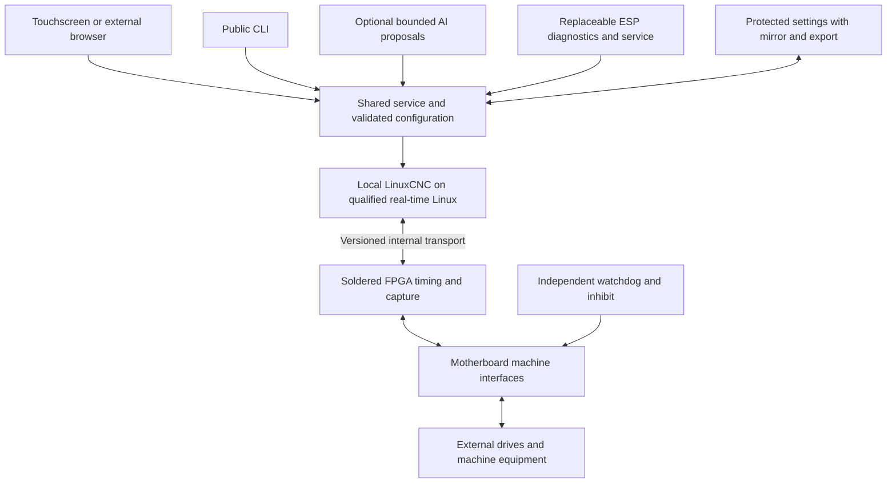

# Controller project briefing

Reconciled **18 October 2026** from [project memory](PROJECT_MEMORY.md), [engineering status](reports/ENGINEERING_STATUS.md) and the [17 October finishing continuation](reports/board-finish-20261017/README.md). This is a documentation review; no engineering check or physical measurement is newly claimed. The [documentation index](docs/README.md) links every topic guide and explains historical evidence.

The product is an approachable standalone machine controller with local real-time control, guided setup, diagnostics, recoverable settings and complete tested kit options. Working disconnected software and substantial circuit/PCB source exist. The integrated board, production image, physical motion performance and complete manufactured cost remain unfinished. **The controller is not ready for PCBWay manufacture or sale.**

## Product and hardware decisions

The 30 September physical decision adopts **one active custom motherboard**. It contains the soldered FPGA, clock/configuration/supervision, all twelve motor interfaces with individual enable and alarm, four base ABZ encoders, 24 general DI and 16 smart general DO, plus required fast probe/frequency, PWM/process, analog, RS-485/CAN, status, power/protection and independent watchdog/permission functions. At least eight motors must be usable; all twelve interfaces remain fitted, with no motor-channel licence unlock. Motor count is distinct from coordinated machine-axis count.

Purchased compute, ESP and storage/settings modules remain replaceable. Qualified specialty accessories can add capabilities while retaining required base resources. The passive fixed base, thirteen-card rack, removable custom FPGA/I/O cards and custom motors-9–12 expansion card are superseded. The old 327-part MC r0.4/revision-14 is reusable partial source/native evidence, not the complete motherboard. [IS-2](docs/MOTHERBOARD_IS2.md) retains logical ownership, fault/default behavior, calibration and data-integrity contracts without inventing removable-card presence for integrated regions.

The operator experience should preserve the preferred Octopus/MR-1 workflow: select equipment, see correct wiring, establish scale/direction and physical registration, preview work and operate without editing code. CAD import and a no-CAD parametric path remain requirements; a complete importer, collision engine, measured-position model and commissioned machining workflow are not established by the setup prototype. See [product experience](docs/PRODUCT_EXPERIENCE.md) and [flagship workflow](docs/FLAGSHIP_WORKFLOW.md).

## Control and software

The workstation stays outside the hard real-time loop. LinuxCNC owns planning and machine integration; the FPGA generates/captures deterministic signals. Ethernet, USB and qualified wireless interfaces serve operator/files/diagnostics roles. Bandwidth or connector shape does not establish a motion deadline or electrical compatibility. External drives supply motor winding power.

The common setup service, public CLI and browser UI now implement disconnected intake, typed configuration, validation, before/after review, revision-bound save, readiness/self-check, backup recovery and bounded diagnostics/packages. The dark/red appliance provides Machine, Setup, Diagnostics, Files and Settings destinations. Interface reset/undo is reversible; full machine reset remains blocked. Files performs approved read-only package validation/download. See [setup](docs/SETUP_WORKBENCH.md), [CLI](docs/CONFIGURATION_AND_CLI.md), [diagnostics](docs/DIAGNOSTICS_AND_PACKAGES.md) and [OS](docs/CONTROLLER_OS.md).

AI remains optional and budget guarded. Proposals pass through ordinary validation and review; an assistant has no raw actuation authority. Normal operation, local guidance, saved jobs and recovery must remain usable offline without AI credits. Current ESP firmware is diagnostic-only; supporting-equipment sequences need their own circuits, measured readiness, one output owner, dependency faults and deliberate recovery. See [AI setup](docs/AI_SETUP_CONTRACT.md) and [ESP accessories](docs/ESP_ACCESSORY_AUTOMATION.md).

## Compute, displays and storage

The adopted compute bay uses the CM4/CM5 dual-100-pin family; native source includes actual three-bit DIP readout. Primary-source contact checks exist for CM4/CM5, while exact variants, Linux images, pinmux, loaded real-time behavior, graphics, power and cooling still require qualification. CB1/CB2 remain separately unqualified. The selector neither routes power nor grants permission; AUTO stays service-only until identity is verified. Automatic pre-power identification and production software-profile selection are not implemented. See [carrier strategy](docs/COMPUTE_CARRIER_STRATEGY.md) and [selector](docs/COMPUTE_MODULE_SELECTOR.md).

Prepare the matching image and recovery route for each qualified module. Lite variants may use qualified removable SD; equipped modules use eMMC; NVMe is optional only where exact hardware and boot support it. The base remains usable without an SSD. Replacing a compute module changes RAM capacity; an SSD is not RAM. Protected microSD circuitry in source does not qualify a card, image or interrupted-save recovery system. [Boot/storage/provisioning](docs/BOOT_STORAGE_AND_PROVISIONING.md)

Display classes are **7, 10, 12, 14, 18 and 21 inches**, with further qualified sizes allowed. A shared responsive application adapts to each qualified panel. Screen size does not reduce fitted I/O or software entitlement. Exact panels, launch packages, touch/graphics/thermal behavior and complete costs remain open. Older 21.5-inch/six-joint studies retain their own scope. [Display tiers](docs/DISPLAY_TIERS.md)

## Service, faults and settings

First-release service is power-off exchange of approved purchased modules or a whole-motherboard replacement using keyed pluggable terminal/harness groups. Preserve conductor terminations, labels and complete machine settings. Whole-board exchange requires moving terminal groups, verifying compatibility/calibration and repeating affected checks. There is no adopted five-minute whole-board service guarantee. Virtual grouped-card demonstrations remain software evidence. [Repair and machine memory](docs/MODULAR_REPAIR_AND_MEMORY.md)

The required protected recovery payload must contain the actual versioned configuration, with two validated committed records, a main-storage mirror and offline export. The physical media and complete recovery path still require qualification. Keep machine assignments separate from board/module identity, factory calibration and firmware/Linux images. New-compute import is distinct from same-store backup recovery. Replacement must retain legitimate offline entitlement without repurchase, but never restore homing, known position or motion/job authority automatically.

Retain identity, sequence/freshness and CRC checks before serially communicated outputs change; independent watchdog/inhibit; safe boot/reset/missing-module defaults; and deliberate fault recovery. The 20 ms fault-to-inhibit requirement is an acceptance requirement, not a complete measured result. Immediate electrical inhibition does not prove controlled stopping, workholding or gravity-axis safety. Observations must show validity and age; stale/unavailable readings cannot silently become zero. [Supervisory contract](docs/SUPERVISORY_CONTRACT.md), [protection](docs/POWER_PROTECTION.md), [status indicators](docs/STATUS_INDICATORS.md)

## Recorded engineering evidence

| Workstream | Recorded scope | Remaining boundary |
| --- | --- | --- |
| Adopted hardware | Source26/ROOT104, published CAD30: 2,688 footprints, 3,508 required joins; ordinary native DRC 0 errors/0 warnings; Source26 ERC 0 errors/70 warnings | Incomplete routing; distinct from later experimental revisions |
| Finishing continuation | Recovered R299 full native evidence: 1,172 required joins, 1,183 API items, 0 ordinary errors/333 warnings/0 parity issues | Source-reference/contact failures and electrical/assembly qualification remain explicit |
| Isolated corrected baseline | Three header BOM corrections and duplicate-via retirement retain 1,172 joins; cached-fill DRC 0 errors/332 warnings/0 parity issues; separate circuit ERC 0 errors/92 warnings | No fresh refill in that cached DRC check; no adoption or manufacturing promotion |
| Composed routing stages | Stage1 full native refill/AFTER qualification remains pending in the cited record; stages2–4 have native input/geometry checks | Cached fills cannot establish new joins, current capacity or physical AFTER behavior |
| Corrected SIM2 | Canonical disconnected source includes registered RAM/bypass, seven-producer FIFO and transport alignment corrections; actual mapped core: 15,805 LUT4 + 2,107 ADD = 17,912; 10,441 FF, 63 RAM5K, one multiplier | Complete physical-wrapper insertion, vendor place/route, routed timing, bitstream and target qualification remain open |
| Integration/mapped behavior | Fresh actual LinuxCNC task/FREE-joint planners/HAL → C driver → shifted SPI → selected RTL → independent virtual plant passes for twelve and eight active joints, all twelve fitted; mapped event-engine simulation has 23,596 comparisons | No Cartesian machining, G-code/homing, physical feedback authority or loaded target deadline qualification |
| Historical CNC1 | Six-joint/two-encoder runtime, compiled driver/RTL and persistent XYZ calibration records retain original sources | Historical baseline; no relabelling as eight-/twelve-channel qualification |
| Setup/OS | Shared-service workbench, diagnostics, packages, browser UI and deterministic overlay have source-bound host/Linux/browser evidence | No signed bootable production image, physical kiosk/boot, measured frame pacing or full physical service validation |

[Engineering status](reports/ENGINEERING_STATUS.md) and the [continuation](reports/board-finish-20261017/README.md) contain exact receipts, hashes, failures and preservation scopes. Zero ordinary DRC errors do not imply zero required joins or current/assembly/safety qualification. Source inspection, host tests, target compilation, HDL simulation, mapping, circuit ERC, board DRC and physical measurements remain distinct. [Acceptance gates](docs/CURRENT_ACCEPTANCE_GATES.md)

The timing target remains twelve simultaneous channels at up to 2 MHz/channel, per-drive high/low/setup/hold/polarity/rate limits and atomic updates in a deterministic 1 kHz servo cycle. The 700 µs exchange budget, four base ABZ and expansion toward twelve ABZ require complete resource/protocol/pin/current/timing evidence. Preserve current 96-byte command/176-byte feedback frames and enforced rates until a qualified revision changes them. These targets are not shipped ratings. [Motion contract](docs/MOTION_EXPANSION_8_TO_12.md)

## Cost, manufacturing and commercial scope

US$400 remains a **preliminary controller-assembly reference**, not a demonstrated complete cost or fixed screen bundle. Each kit discloses and costs its exact screen, compute, supplies, enclosure, harnesses, software and setup scope. Drives, motors and machine field supplies remain separate unless expressly included. Required fitted I/O cannot disappear to meet a price.

The immutable Source26 [cost audit v11](reports/motherboard-cost-20260930/source-r26-2688-complete-cost-v11/README.md) covers 2,688 footprints: 2,642 purchased fitted parts, 44 bare PCB features and two DNPs. It prices 105 exact MPNs; 185 MPNs/720 fitted pieces remain unpriced. Known-priced consumed inventory per board at 1/10/100 units is **US$1,091.51/$877.37/$796.51**. Catalogue purchase cash for those whole builds is **US$61,020.80/$67,419.50/$131,032.35**, including unused MOQ inventory. These dated partial baskets do not price the later finishing revision or complete controller. Modules, displays, fabrication, assembly, programming/test, enclosure and packaging stay separate unknowns.

Cost the fitted motherboard, approved modules, accessories, spares and complete display packages at 1/10/100/1,000 units. Count protection, diagnostics, connectors/mates, thermal/mechanical work, manufacturing losses, fixtures and test time. Missing quotes are not zero and volume discounts need evidence. Research offers remain dated; actual supplier availability/capability and final quotations require verification for the completed design.

PCBWay turnkey is the selected route after engineering closure. Final source/ERC, routed PCB/DRC/connectivity, approved stackup/mechanics, real fabrication/drill/CPL/BOM/assembly data, versioned programming and factory-test scope remain release requirements. Never generate placeholder fabrication files. [Submission checklist](manufacturing/PCBWAY_SUBMISSION_CHECKLIST.md)

The commercial direction is controller hardware, paid offline original software, capability accessories and complete tested kits, with ordinary supported peripherals sourceable elsewhere. Replacement entitlement, third-party licences, supported profiles and support obligations remain explicit gates. [Commercial policy](docs/COMMERCIAL_MODEL_AND_LICENSING.md)

## Engineering priorities

1. Finish source-bound routing and native AFTER audits without losing retained pad/contact/source relationships. Resolve signed power/return/thermal, ordinary SMD-via assembly, signal integrity and mechanics.
2. Complete the physical FPGA wrapper, actual-device implementation and routed timing with every fitted function and actual limit retained. Preserve corrected disconnected SIM2 and reproducible integration evidence.
3. Bind configuration, capabilities, telemetry and stopped-state authority through the common service; qualify the flagship machine workflow, faults and deliberate recovery.
4. Qualify exact compute/display/storage images, real-time/graphics loading, boot/update/recovery and board/module service. Complete costing against the implemented design.
5. Finish manufacturing/test data, then measured electrical, motion, environmental and whole-unit qualification. Novice-setup and 72-hour combined-load/fault targets remain measurements to perform.

The [200-feature catalogue](docs/FEATURE_CATALOG.md) retains stable proposal IDs. Plasma, third-party Modbus, printer/laser/specialty interfaces and advanced functions follow separate compatibility and qualification paths. Roadmap inclusion is not implemented capability. See [build plan](docs/BUILD_PLAN.md), [roadmap](docs/PLATFORM_ROADMAP.md) and [Rev A qualification](docs/REV_A_QUALIFICATION.md).

The [pre-refresh briefing](reports/documentation-refresh-20261018/before/PROJECT_BRIEFING.md) is retained as a documentation snapshot. Its old card architecture, expansion allocation and earlier evidence are historical.
