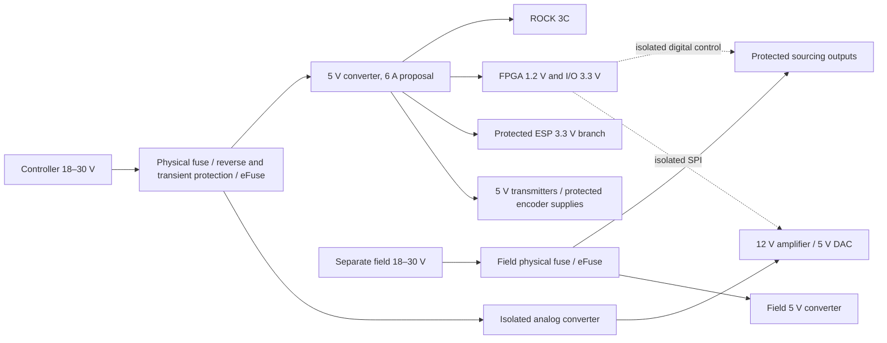

# Electrical design review package

Reviewed 18 October 2026. [Documentation index](README.md) · [current engineering evidence](../reports/ENGINEERING_STATUS.md).

The current electrical architecture is [IS-2](MOTHERBOARD_IS2.md): one active motherboard with soldered FPGA, all twelve STEP/DIR interfaces with individual enables/alarms, four ABZ, 24 general DI/16 smart DO and the retained process, analog, communications, protection and status functions. Purchased compute, ESP and storage/settings modules remain replaceable. The latest [17 October board continuation](../reports/board-finish-20261017/README.md) retains 1,172 required joins in recovered R299; its isolated corrected cached DRC is 0 ordinary errors/332 warnings/0 parity, with physical/current/assembly/manufacturing qualification still open. Stage1 full refill is pending; stages2–4 have input checks only. No hardware adoption or qualified product rating follows from those checks.

Revision electrical-r0.1 below preserves the **historical 28 September six-joint/two-encoder study** and editable two-joint/six-joint/two-ABZ circuit blocks. Its resource counts, power reservations, circuit choices and implementation gaps retain their original artifact scope. They are reusable source evidence, not the all-twelve motherboard's complete ledger or current release state. Numerical limits remain unchanged by this review.

## Historical six/two artifacts and how to review them

- [Electrical ledger](../WORKSPACE_REFERENCES.md#artifact-97006e6312daee65): interfaces, actual device-channel assignments, power domains, estimated rail reservations, component/support inventory, permission contract and blockers.
- [Channel allocation](../WORKSPACE_REFERENCES.md#artifact-118ac88dc6dbe6ca), [terminal allocation](../WORKSPACE_REFERENCES.md#artifact-6985bbf5fca7afaf), [power budget](../WORKSPACE_REFERENCES.md#artifact-8480d04ab2736bfa), and [BOM snapshot](../WORKSPACE_REFERENCES.md#artifact-325cd5cd47164739): generated views. The BOM contains candidate parts and required support bundles, including unresolved MPNs; it is not a purchasing BOM.
- [Two-joint transmitter schematic](../WORKSPACE_REFERENCES.md#artifact-0c59f0f6193084a9), [project](../WORKSPACE_REFERENCES.md#artifact-24dd6e35c3d8bdc8), [PDF](../WORKSPACE_REFERENCES.md#artifact-8544276665e811f8), [netlist](../WORKSPACE_REFERENCES.md#artifact-7e95f3e9f9991b9b), [circuit BOM](../WORKSPACE_REFERENCES.md#artifact-bfad2c596f6cedc8), and [ERC report](../WORKSPACE_REFERENCES.md#artifact-db82d00da924414f). The embedded/project-local symbols make the circuit editable without downloading a symbol library.
- [Six-joint transmitter block](../WORKSPACE_REFERENCES.md#artifact-6d14e83e89cbf495): three AM26C31 banks and all twelve STEP/DIR channels, with [PDF](../WORKSPACE_REFERENCES.md#artifact-7c49c8c359ed449c), [netlist](../WORKSPACE_REFERENCES.md#artifact-b3b70f98f61d2ae2), [circuit BOM](../WORKSPACE_REFERENCES.md#artifact-737ede931573ebe1), [ERC report](../WORKSPACE_REFERENCES.md#artifact-97378bae077b90ce) and [validation record](../WORKSPACE_REFERENCES.md#artifact-b9cae69e444b6380); described in [SIX_JOINT_TRANSMITTER.md](../reports/SIX_JOINT_TRANSMITTER.md). Regenerate with `python tools/hardware_build_tx_six.py`, validate with `python tools/hardware_validate_tx_six.py`.
- [Two-ABZ receiver block](../WORKSPACE_REFERENCES.md#artifact-07f777feb9780818) with its [ERC report](../WORKSPACE_REFERENCES.md#artifact-eac74a3509fa164c) and [validation record](../WORKSPACE_REFERENCES.md#artifact-64cc8412f8e27df9); described in [ENCODER_RECEIVERS.md](../reports/ENCODER_RECEIVERS.md).
- [Executable review](../WORKSPACE_REFERENCES.md#artifact-2b302aef01c2e638) and [fault-injection tests](../WORKSPACE_REFERENCES.md#artifact-75ea56cc11e2193d). A passing consistency result is distinct from manufacturing release. `--release` fails while design/qualification blockers remain.

Regenerate the ledger with `python tools/hardware_build_design.py`; regenerate the review circuit with `python tools/hardware_build_tx_schematic.py`. Regeneration overwrites generated artifacts, so commit/edit the generator when changing their authoritative definitions, or preserve manual schematic changes before regenerating. Never replace a finished manually reviewed board with this circuit generator.

## Historical host choice for the six/two study

This study used the assembled **ROCK 3C RS112-D2** engineering-host proposal and retained **CM3 SODIMM RM117-D2E16** as a carrier comparator. These historical host selections are superseded for the product by the CM4/CM5 mechanical compute bay with separately qualified CM4/CM5/CB1/CB2 profiles. Their network/video/USB provisions and dated merchandise comparison do not establish current motherboard cost or LinuxCNC qualification. [Radxa ROCK 3C study source](https://radxa.com/products/rock3/3c/), [CM3S study schematic](https://dl.radxa.com/cm3s/docs/hw/RADXA_CM3S_V1.5_SCH.pdf)

The host runs local LinuxCNC, services and the preserved UI. Motion SPI is a dedicated internal link; the host's Ethernet/Wi-Fi/USB serve the customer interface. The Raspberry Pi-specific SPI driver cannot simply be assumed to work on Rockchip. The new gateware reference is a custom protocol, not HostMot2 compatibility. No host GPIO or FPGA ball is assigned until the real peripheral/package review is complete.

The ESP uses a separate 3.3 V branch. Its proposed board signals are UART TX/RX, observed `PGOOD`, observed `MOTION_DISARMED`, and local recovery/debug. **No STEP, enable, host-reset, watchdog-service, or analog-command authority connects to the ESP.** Its optional GPIO configuration defaults to disconnected in firmware. Hardware must prevent backfeeding through UART/status when either side loses power.

## Historical six/two interface proposal and allocation

| Interface | Proposed electrical contract | Capacity / remaining gate |
|---|---|---|
| STEP/DIR | 5 V-supplied differential transmitters; 3.3 V logic inputs; no galvanic isolation | 6 joints / 12 signals. Initial target 250 ksteps/s, 2 µs minimum STEP high/low and DIR guard; actual drive and cable can impose slower limits. |
| Encoder | Differential A/B/Z, 3.3 V receiver logic; two protected 5 V, 200 mA encoder supplies | Two encoders / 6 signals; 1 Medge/s per signal study target. These are not six joint feedback ports. Receiver termination, common mode, open-wire state and cable tests remain open. |
| Inputs | 22 sinking nominal-24-V DC channels for PNP outputs or contacts switching field positive | 0–30 V input target; low 0–5 V, high 15–30 V, intermediate undefined. Group isolation to logic; no NPN/AC/universal-voltage claim. |
| General outputs | Eight nominal-24-V sourcing channels, 18–30 V field supply | 0.5 A continuous target/channel, 2 A per four-channel bank. Load inrush, clamp energy and thermal limits unqualified. |
| Drive enables | Six separate sourcing channels, same field supply | 50 mA target/channel; drive must accept this electrical type. These do not provide rated STO. |
| Spindle analog | Isolated 0–10 V, minimum 10 kΩ receiver load | One DAC/amplifier path: DAC80501 internal 2.5 V reference at gain 1 (0–2.5 V) into an OPA197 gain-four stage (30k/10k) on the 12 V rail, leaving ≥2.35 V DAC headroom at the 4.85 V analog-5 V minimum and ≥1.4 V amplifier headroom at 11.4 V; a 0–5 V DAC range with gain two cannot reach 10 V below a 5 V rail. Physical zero clamp, accuracy, filtering, monitoring and short protection incomplete. Separate spindle run must also turn off. |

Six homes, probe, toolsetter, door/protective-system status, spindle fault/ready, hold/start, lubrication status and one spare use all sixteen general inputs. Six drive alarms are additional. Eight general outputs include spindle run/direction, flood, mist, lubrication, air and two spares. Separate positive/negative limits on every joint need expanded input capacity.

**The historical 250 ksteps/s electrical goal is physically unqualified.** The six/two reference caps the accumulator increment at `0x01000000`, giving **195,312.5 steps/s at 50 MHz**. Keep that implementation limit separate from the desired electrical capability and the later twelve-channel 2 MHz qualification target. Neither is a measured end-to-end machine rate; changing the cap or pulse timing needs renewed source-bound implementation and electrical validation.

The ledger maps 54 direct digital signals plus 30 support/reserved signals: **84 proposed GPIO uses**, before resolving dedicated configuration resources and bank restrictions. The current endpoint reference itself exposes 31 pad signals: clock/reset/inhibit, four SPI wires, twelve STEP/DIR, six ABZ, motion permission, endpoint-ready and four fault indications. `spi_miso_oe` belongs inside the board wrapper; it is not another external pad.

The 96-position terminal study preserves the earlier 12 × 8 pricing provision. It includes 74 necessary signal/reference positions, power/commons and six explicitly unconnected reserve positions. Connector positions are proposed terminal labels; they are not footprint/package approval. The mixed supply/reference allocation at `JPOWER` needs keying/layout review and may split into multiple connectors. The schematic's J1/J2 are boundary connectors for a standalone two-joint circuit, not that final terminal product.

## Retained transmitter circuit and voltage compatibility

The retained two-joint review circuit (`hardware/tx_bank`) implements one **AM26C31IPWR** bank with four series-resistor provisions, four data pulldowns, one enable pulldown, 100 nF bypass and 1 µF local bulk. The six-joint block (`hardware/tx_six`, [report](../reports/SIX_JOINT_TRANSMITTER.md)) now draws that bank three times as U1/U2/U3 for ledger TX0/TX1/TX2 with all 24 JTX positions; it passes KiCad ERC and exact netlist/ledger checks, but it is still a block, not the controller schematic. U1 pins 1/7/9/15 are data, 2/6/10/14 noninverting outputs, 3/5/11/13 inverting outputs, 4 active-high enable, 12 active-low enable, 16 supply and 8 ground. The exported netlist is checked against this PW16 map. [TI AM26C31 Rev. P](https://www.ti.com/lit/ds/symlink/am26c31.pdf)

Tie active-low enable high; pull active-high enable low. With permission absent, the driver pair becomes **high impedance**. That does not establish a defined low level at an arbitrary drive. Specify remote receiver fail-safe/bias and remove drive permission independently. Enabling/disabling can create a transition at the receiver; no glitch-free claim exists without the actual load/cable test.

The 5 V driver accepts TTL thresholds (high ≥2 V, low ≤0.8 V). A properly configured 3.3 V FPGA bank can therefore drive its logic inputs; no 5 V pull-up belongs on an FPGA net. The T20 offers 3.3 V I/O but is not a 5 V-tolerant GPIO device. The historical F256 headline of 195 GPIO is not a complete usable bank/ball plan. The C4 in this old study is commercial grade; later source/vendor work targets T20F256/I4 and reports 135 assigned pins/seven source-defined 3.3 V banks. That later interface check does not qualify the whole physical wrapper or its timing. [Dated Efinix T20 v6.0 source](https://www.efinixinc.com/docs/trion20-ds-v6.0.pdf)

Initial 33 Ω source damping and 10 kΩ defaults require signal-integrity review. They do not provide external surge protection or prevent every partial-power injection path. The circuit has no FPGA, hardware-permission latch, line protection, or approved connectors. ERC checks its drawn connections; it does not qualify those missing blocks or the complete controller.

## Historical six/two isolation and power tree

`LOGIC_GND`, `FIELD_GND`, `ANALOG_GND` and chassis/PE are distinct nets. Inputs share their field domain, not channel-to-channel isolation. STEP/DIR and encoders are unisolated and refer to logic ground. An external drive that ties its signal and 24 V commons can bridge those domains outside the board; the compatible machine wiring must disclose that rather than promising complete system isolation.

ISO1212 already supplies input isolation: do not price another isolator per input. Its proposed Type-3-style network uses 562 Ω sense resistance and 1 kΩ threshold resistance; the manufacturer specifies pulse-capable 0.25 W MELF threshold resistors and local bypass. Filter values and probe/toolsetter delay require a separate tolerance/timing calculation. [TI ISO1212 Rev. G](https://www.ti.com/lit/ds/symlink/iso1212.pdf)

Four ISO7740F devices carry sixteen forward command channels, fourteen used. A fifth device faces the opposite direction for four aggregate bank faults. A sixth carries analog SPI/control. ISO7740 has four same-direction channels; it is not a three-forward/one-return device. Power both sides from their respective domains and retain external command pulldowns. Its F suffix supplies default-low behavior under specified loss-of-input conditions. [TI ISO7740](https://www.ti.com/product/ISO7740)

The T20 needs sequenced core and I/O rails, external configuration storage, clock, reset/configuration straps, debug and bypass for its exact package. Those items were incomplete in this six/two ledger. Later integrated source has exact-part and pin/bank work; reconcile its current hashes, package/constraints, default states and full rail/return behavior before release. Follow the manufacturer's unused-resource connections as well as active-power sequencing; do not invent a spare 2.5 V rail from another package's block diagram.

| Rail reservation | Estimated budget | Proposed capacity | Meaning |
|---|---:|---:|---|
| Main 5 V | 5.35 A | 6 A | SBC 3 A, transmitters 0.6 A, encoders 0.4 A, local conversion inputs (computed at 85% efficiency plus an explicit 0.05 A reserve each) and miscellaneous remainder. Less than 20% capacity headroom. |
| FPGA/I/O 3.3 V | 0.40 A | 1 A | Unmeasured allowance; FPGA switching estimate absent. |
| ESP 3.3 V | 0.70 A | 1 A | Separate branch and radio/startup allowance. |
| FPGA 1.2 V | 0.80 A | 1 A | Reservation, not a synthesized power estimate. |
| Field 24 V | 4.36 A | 6 A | Includes maximum proposed output loads; supplied separately from compute/display. |
| Field 5 V | 50 mA | 100 mA | Isolators, gate and diagnostic allowance. |
| Analog 12 V | 30 mA | 83 mA candidate | Includes downstream analog 5 V load; do not add it again at parent rail. |

With assumed 85% main-converter efficiency and 18 V minimum input, the 5 V reservation requires about 1.75 A input; analog provision raises core entry to 1.81 A. Converter efficiency is a calculation assumption. The 90 W adapter in the old costing basket is not approved: monitor voltage/power/startup behavior and remaining losses/headroom still need closure.

The power review changes two earlier cost provisions: **TPS62160 quantity 2 → 3**, for core, I/O and independent ESP rails; **TLV76050 quantity 2 → 1**, retaining only the analog rail. At 50 mA the former field LDO would dissipate 0.95 W from 24 V and 1.25 W from 30 V. Replace that role with an unselected field buck pending thermal design. TPS62160 accepts 3–17 V input; never connect it directly to nominal 24 V. [TI TPS62160](https://www.ti.com/lit/ds/symlink/tps62160.pdf)

## Retained protection rules and historical six/two permission model

Provide separately coordinated physical DC entry fuses for core and field power. Electronic branch protection controls overload/inrush and exposes useful diagnostics; the existing TPS4H160 channels already provide protected switching. Fuse voltage/current/breaking capacity, cable ampacity, source foldback, time-current/I²t, inrush, semiconductor SOA and inductive energy remain explicit selection inputs. Do not infer that a fuse will clear from its ampere marking alone.

TPS2663 is a candidate family, not a selected complete circuit: 4.5–60 V operating input, adjustable 0.6–6 A current limit and configurable latch-off. Reverse-polarity protection requires the external FET arrangement. Field protection should latch off; recovery must leave motion disarmed. Exact variant, resistors/FETs/TVS, limit tolerance, power dissipation and fuse coordination are unresolved. [TI TPS2663](https://www.ti.com/product/TPS2663), [project protection strategy](POWER_PROTECTION.md)

The six/two study permission expression is `RAILS_OK AND CONFIG_VALID AND EXTERNAL_PERMIT AND HW_WATCHDOG_OK AND FPGA_ARM_LATCH`, covering its STEP enable, fourteen field commands and spindle permission. IS-2 retains the actual independent permission cuts across **all twelve motors and all required DO/PWM/process/AO paths**; the old fourteen-command count is not its full output inventory. Clear arm latches on fault/reset and require explicit rearming. Hold arm-related controls low during boot/update; direction and analog state alone never confer permission.

The FPGA watchdog monitors accepted motion progress. In this old circuit study the separate TPS3431 was a candidate for lost FPGA execution/clock/configuration; its WDI must represent useful completed control work, not a free-running toggle or ESP/network heartbeat. The reference endpoint implements a 5 ms timeout (`WATCHDOG_CYCLES = 250000` at 50 MHz, recorded as `permission.rtl_watchdog_ms`); the ledger's `permission.external_watchdog_study_ms` is 20 ms. **IS-2 requires the complete fault-to-inhibit path to stay within 20 ms**, including the last STEP and relevant output responses. The old part/timing study does not meet that requirement merely by naming it. Later permission/watchdog source and simulations exist; complete physical tolerances and loaded response remain unqualified. [Historical TPS3431 source](https://www.ti.com/lit/ds/symlink/tps3431.pdf)

The historical six/two reference lacked the required external useful-progress WDI output; that remains the electrical ledger's historical blocker. Later CNC3/SIM2 progress/default checks must be assessed against their exact source, and a production physical wrapper must carry the real independent watchdog path. Endpoint-ready or a clock-running signal cannot substitute for useful control progress.

| Condition | Required field behavior | Evidence still needed |
|---|---|---|
| Boot, reset, unconfigured FPGA | Driver G low; output commands low; spindle run off | Actual partial-power ramp and pin-default tests |
| Motion watchdog expires | Permission removed and fault latched | Complete gate/latch schematic, propagation and loaded test |
| FPGA clock stops | External watchdog removes permission | WDI coupling, clock-stall injection and timeout tolerance |
| Field power disappears/returns | Outputs remain off until deliberately rearmed | No backfeed; status isolation; latch persistence/reset policy |
| ESP crashes or loses power | Diagnostic service unavailable; no parallel output authority | Branch-short and UART/status partial-power tests |
| Analog command fails | Spindle run withdrawn; command-zero mechanism evaluated | Zero clamp, physical output monitoring and compatible VFD behavior |

These are operational controls. Machine E-stop/STO, brakes and stored-energy control need their own machine-level design. A sudden loss of pulses or power is not coordinated deceleration.

## Release gates and manufacturing handoff

The manufacturing manifest belongs in [manufacturing](../WORKSPACE_REFERENCES.md#artifact-039d6add7ee0b6cf). The historical circuit [review manifest](../WORKSPACE_REFERENCES.md#artifact-27cd1ba783064ed7), regenerated by `python tools/hardware_record_review.py`, binds its own block hashes; it is not the latest complete motherboard release manifest. Use current source/native and vendor receipts from engineering status for current work. No empty Gerber/CPL/PCB files are supplied to satisfy filenames.

PCBWay requires an actual fabrication/assembly Gerber set, BOM and SMT centroid file. The centroid needs reference designators, X/Y, rotation and side; assemble the release package in one revision. Add actual drill/outline data, stackup/fabrication specification, DNP/approved alternatives, assembly polarity/orientation drawings, programming images/instructions, test fixture and quantitative acceptance criteria. Stencil is included in the assembly quotation; programming and functional testing need explicit scope. [PCBWay files](https://www.pcbway.com/assembly-file-requirements.html), [programming](https://www.pcbway.com/helpcenter/pcb_assembly_ordering/What_document_is_needed_for_IC_program_.html), [testing](https://www.pcbway.com/helpcenter/pcb_assembly_ordering/Can_you_do_test_after_assembly__What_documents_should_I_offer_.html)

Before a complete schematic freezes: close the exact device/package/footprint map, all power/default paths, rated circuit support networks, real machine interface/load limits and configuration/recovery plan. Before layout release: close synthesized FPGA fit/timing, reviewed host pinmux, full schematic ERC and controlled geometry/routing/return paths. Before manufacturing authorization: complete board DRC, BOM/CPL/Gerber cross-checks, pricing and programming/test scope. Final product claims additionally require physical bring-up, fault/SI/EMC/thermal tests and machine acceptance.

Editable hardware and firmware remain part of the product. The CLI/UI capability record must report port class, range, load limit, ground/isolation domain, installed option and evidence status. Guided wiring can derive labels and compatible profiles from that record. Neither a custom configuration nor an AI suggestion can turn the current 24 V sourcing output into a dry contact or an arbitrary-voltage port.
