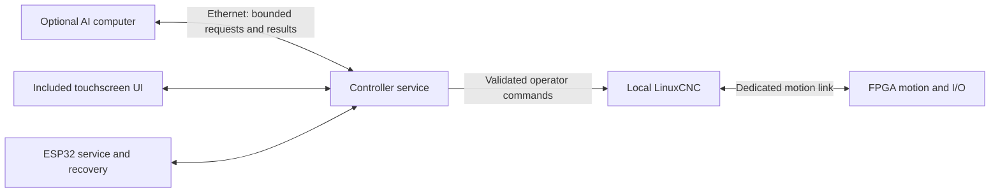

# Optional AI compute — expansion proposal

28 September 2026. Requested by the user while selecting PCBWay turnkey manufacture. This is an addition to the cost study, not a change of motion architecture or a production-component selection.

**Provide AI as an optional separate computer connected over Ethernet.** The base controller continues to contain the Linux machining/UI computer, FPGA motion hardware and ESP32 service processor. The AI companion supplies its own CPU/accelerator, RAM, storage, power and cooling. It can initially be an existing workstation; a dedicated accessory can follow the same software interface.

AI can help interpret manuals and alarms, identify candidate fixtures/tools in camera images, explain setup choices, and propose scene placements. It does not make arbitrary CAD files automatically machine-ready. Units, coordinate registration, kinematics, tool geometry and measured offsets still need deterministic checks and commissioning. Camera measurements require calibration; AI confidence is not a metrology specification.

Proposals enter the existing setup/review workflow with provenance and an operator acceptance step before machine-affecting changes. The assistant has no raw STEP/DIR, interlock bypass or automatic takeover access. If the AI computer disconnects, its requests expire and ordinary CNC operation remains available. An AI response arriving late cannot replay a previous action. These are requirements to implement and test, not implemented behavior.

## Hardware options worth keeping available

Current public USD references, excluding tax/shipping and any separately required host/accessories:

| Option | Price reference | Appropriate workload and limits |
|---|---:|---|
| Existing customer computer over Ethernet | No additional module purchase if suitable hardware is already owned | Fastest development route; local model speed depends on that computer. Base controller still works without it. |
| [Raspberry Pi AI HAT+](https://www.raspberrypi.com/products/ai-hat/) | From $70, accelerator only | Hailo-8L vision inference; requires a Pi 5 host and its power/storage/cooling. This is not a complete Linux computer or the selected local-language-model route. |
| [Raspberry Pi AI HAT+ 2](https://www.raspberrypi.com/products/ai-hat-plus-2/) | $200, accelerator only | Hailo-10H, 8 GB dedicated RAM; selected local language/vision-language models as well as vision. Requires a Pi 5 host. |
| [UP Hailo-8L M.2 2280](https://up-shop.org/default/hailo8l-m22280-key.html) | $89; optional heatsink $10 | 13 TOPS vision accelerator, no independent host. Exact PCIe, driver, power and mounting support must be qualified. |
| [Jetson Orin Nano Super development kit](https://developer.nvidia.com/embedded/faq) | Current official MSRP $399 | A Linux AI computer for development; 8 GB shared RAM, storage required. Production requires a production module/carrier cost study. |

The HAT+ 2's 40 TOPS figure uses INT4; it cannot be compared directly with INT8 figures to rank application speed. [Raspberry Pi's integration documentation](https://www.raspberrypi.com/documentation/accessories/ai-hat-plus.html) describes the Pi-specific PCIe, power and software connection. A 40-pin header on a Radxa board does not establish HAT compatibility.

NVIDIA's current FAQ supersedes older $249 launch-price pages for this comparison. It explicitly identifies development kits as development hardware. Its production Orin Nano 8 GB module is listed at $399 at 1,000+ units, before carrier and accessories. The module's [7–25 W power modes](https://docs.nvidia.com/jetson/orin-nano-devkit/user-guide/latest/) are not a complete enclosure power budget. This belongs in a premium optional upgrade, not in the current base-cost target.

## What to reserve before PCB layout

1. **A stable, versioned Ethernet service interface.** Use the controller's service LAN; an external switch can connect the controller, AI computer and customer workstation. No dedicated second Ethernet port or internal switch is assumed free. Rate-limit image/telemetry requests and prevent the AI process from blocking the motion-service path.
2. **A separately priced mechanical/power option.** An external AI enclosure can use its own supply. An internal version needs module drawings, space, airflow and a protected switched rail with measured peak-load capacity. Do not silently size the base PSU for an unselected high-power module.
3. **Camera and microphone attachment at the AI computer.** This avoids pushing raw streams through the machining host unnecessarily. The controller can exchange selected images and scene metadata when useful.
4. **PCIe only after compute selection.** A future M.2 option needs the correct key, lanes, reset/reference clock, 3.3 V rail, connector clearance and supported drivers. The currently studied RK3566 interfaces and ROCK 3C slot geometry do not establish compatibility with the cited 2280 accelerator. NVMe and AI also cannot independently occupy the same single PCIe link without additional hardware.

Ethernet supplies a common interface across future AI modules. It does not guarantee motion isolation by itself: bounded service load, CPU scheduling, watchdog behavior and malformed/disconnected-client tests are still required. Sharing a Linux host with an accelerator would add CPU, memory, interrupt and thermal interactions even if the accelerator has its own RAM.

## Next design artifact

Define two initial optional features—manual/alarm assistance and camera-assisted setup—and their data contracts, model/license requirements, memory limits and offline performance tests. Then compare complete AI accessory costs including host, storage, power, cooling, camera and enclosure. Do not select a socket or accelerator from TOPS or bare chip price alone. The base-controller workbook excludes these optional items.
