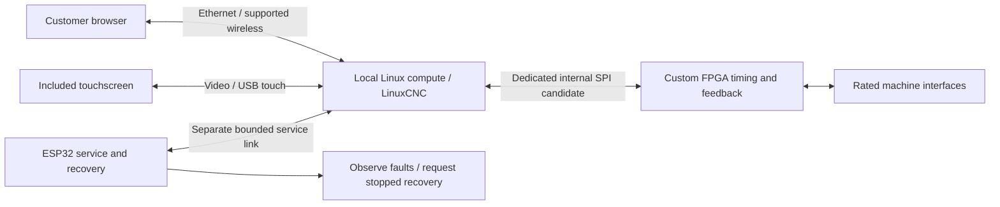

# CM5–FPGA SPI: source review and proof gates

28 September 2026 UTC. Read-only source investigation prompted by the user's pasted architecture review. No FPGA port, LinuxCNC hardware test or latency measurement has been performed.

## Finding

Investigate a dedicated short SPI link inside the enclosure before adding an internal Ethernet endpoint. Customer Ethernet still terminates at the Linux computer. This is a transport feasibility direction, not a claim that an arbitrary SPI FPGA already works with LinuxCNC or that SPI solves the product cost gap.

The reference is LinuxCNC **v2.9.10**, resolved to commit **86cdca76fa2a36274c432caa21952b23c267989a**. This is the revision audited, not a promise that later versions behave identically.

| Source finding | Evidence | Consequence |
|---|---|---|
| The dedicated Pi 5 SPI driver explicitly matches both Pi 5B and Compute Module 5 | [spix_rpi5.c detection](https://github.com/LinuxCNC/linuxcnc/blob/86cdca76fa2a36274c432caa21952b23c267989a/src/hal/drivers/mesa-hostmot2/spix_rpi5.c#L507-L517), [device-tree identifiers](https://github.com/LinuxCNC/linuxcnc/blob/86cdca76fa2a36274c432caa21952b23c267989a/src/hal/drivers/mesa-hostmot2/dtcboards.h#L34-L66) | CM5 recognition is already present in this revision. The exact carrier/image/pinmux and loaded timing still need proof. |
| SPI board lookup recognizes the listed Mesa identities and rejects an unknown board | [board table](https://github.com/LinuxCNC/linuxcnc/blob/86cdca76fa2a36274c432caa21952b23c267989a/src/hal/drivers/mesa-hostmot2/llio_info.c#L171-L216), [lookup/rejection](https://github.com/LinuxCNC/linuxcnc/blob/86cdca76fa2a36274c432caa21952b23c267989a/src/hal/drivers/mesa-hostmot2/llio_info.c#L220-L253), [caller](https://github.com/LinuxCNC/linuxcnc/blob/86cdca76fa2a36274c432caa21952b23c267989a/src/hal/drivers/mesa-hostmot2/hm2_spix.c#L461-L482) | Define an honest custom board identity and appropriate LLIO support, or a justified alternative driver. Do not impersonate a Mesa board to bypass the check. |
| hm2_spix expects compatible SPI HostMot2 firmware, with dedicated Pi drivers and a spidev fallback | [driver manual](https://linuxcnc.org/docs/2.9/html/man/man9/hm2_spix.9.html) | A custom Efinix register file is not automatically compatible. A cheaper Linux module also needs its own transport/timing qualification. |

The manual documents uspace real-time use, suggests 12.5 MHz as a starting SPI clock, and warns against conflicting kernel and direct hardware SPI access. Higher reported clock results apply to tested Mesa hardware, not our proposed carrier. Reserve the motion bus and document exclusive driver ownership; do not silently share it with storage, touch or service tasks.

## Proposed physical responsibilities

The local computer renders the included display UI as well as running the control backend. The pasted review's client-only rendering assumption is superseded by the later included-screen requirement. The ESP does not gain parallel actuator ownership.

## Custom FPGA work still required

1. Choose a reusable gateware basis and pin its source/build tools. The upstream [HostMot2 SPI top-level example](https://github.com/LinuxCNC/hostmot2-firmware/blob/master/src/TopGCSPIHostMot2.vhd) uses Xilinx-specific clock resources; using it on T20 requires replacement and verification. Audit clock/reset structures, RAM inference, I/O and configuration paths. Record applicable source/tool distribution requirements. The example is a source lead, not a completed pinned T20 build.
2. Define custom board identity, connector and pin descriptors, supported HostMot2 modules/register behavior, clocks and matching host LLIO configuration. A valid identity alone is insufficient.
3. Verify step-generator timing/feedback, encoder/index semantics, input capture, register consistency, command update behavior and watchdog response. Build host/FPGA compatibility tests against the actual chosen implementation rather than an invented look-alike protocol.
4. Select and synthesize the exact device/package with real constraints. Review clock-domain crossings, SPI read timing, I/O-bank voltages and all reserved pins. Record resource and timing reports. Compare BGA and LQFP total implementation cost; no synthesis is presently complete.
5. Define the target-specific programming, interrupted-update and rollback procedure. Existing Mesa bitstreams/programming assumptions must not be treated as an Efinix programming solution.

The audited [SPI command definition](https://github.com/LinuxCNC/linuxcnc/blob/86cdca76fa2a36274c432caa21952b23c267989a/src/hal/drivers/mesa-hostmot2/spix.h#L156-L179) uses 32-bit command/data words with addressed read/write and bursts up to 127 data words. Startup identity checks and all advertised module semantics remain part of compatibility. Configuration-flash SPI and the runtime motion-register SPI endpoint are different functions.

Efinix advertises integrated flash for the **LQFP100F3** package and separately lists a 144-pin LQFP option. Do not assume all T20 LQFP packages include flash. The exact part's pin/bank map and available resources decide whether it fits the [core interface](../docs/CORE_INTERFACE_COSTING.md). [Manufacturer package information](https://www.efinixinc.com/products-trion.html)

## Timing and failure gates

For a proposed 1 kHz servo thread, the whole cycle has a 1 ms deadline. Budget scheduling delay, SPI reads, control computation, writes and margin together. Account for command headers and actual transfer grouping, not just payload divided by nominal SPI frequency. Measure the selected image under local 3D rendering, realistic storage/network work and thermal load. A working SPI transfer or a successful simulation is not deadline evidence.

HostMot2's documented watchdog makes its I/O high-impedance after expiry; it does not promise coordinated deceleration. Carrier pull states and output-driver gates must translate that behavior into specified field-terminal states. Watchdog clearing must not by itself restore machine permission. A still-running FPGA counter does not prove retained physical machine position. [HostMot2 watchdog documentation](https://linuxcnc.org/docs/2.9/html/man/man9/hostmot2.9.html)

Our proposed acceptance cases include expired servicing, LinuxCNC exit/stall, Linux reset, FPGA reset, broken SPI and corrupted/truncated transfers where detectable. Determine the real protocol's integrity/fault-detection coverage from its implementation; do not assume an SPI link detects every bit error. Test external output behavior rather than relying only on software fault flags.

The ESP's separate power/reset branch should preserve diagnostics for the specified Linux failures. It does not create power-loss redundancy. An ESP software crash should not interrupt the primary control loop when the ESP is only a service helper; shared supply shorts, bus faults and any later critical ESP role require separate analysis. Reset requests during machining must follow the defined fault/stop policy.

## Development order

Do source audit, host identity/descriptor design, gateware simulation/synthesis, pin/bank mapping, power/default-state review and complete cost blocks before procuring a link prototype. A bounded later bench setup must demonstrate a real encoder counter, real step output, full-cycle timing and defined failure response before production PCB layout is finalized. Existing compatible equipment may be reused where available. Final qualification still needs the custom hardware.

Preserving the UI and integrating actual LinuxCNC simulation proceeds in parallel. A finished CAD importer is not a prerequisite for proving the motion link. Conversely, a working motion link does not demonstrate that the desired display/3D workload fits the same computer or the product's selling price.
