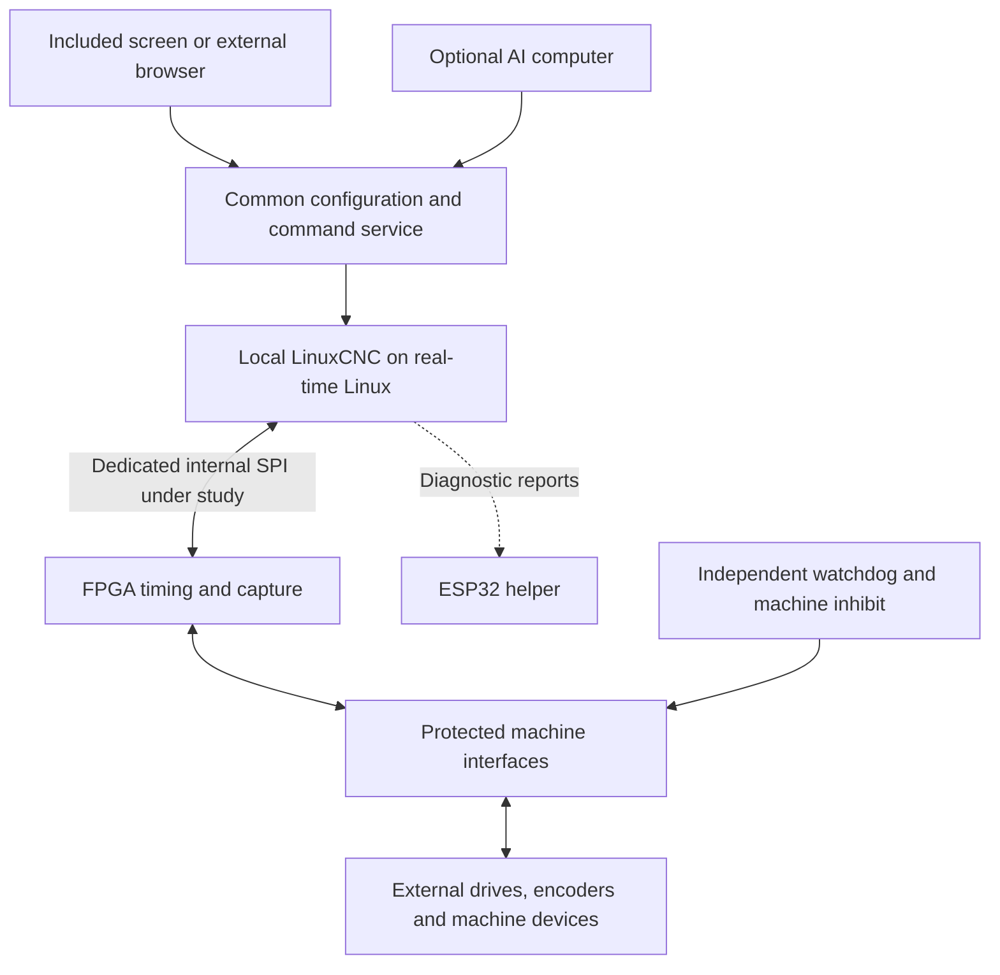

# Controller project briefing — requirements reconciled 30 September 2026

We have a coherent product direction, substantial research, executable software building blocks and a partial electrical design. We do not yet have a complete integrated controller, a production PCB, demonstrated physical machine performance or a viable complete-unit manufacturing cost. No parts have been ordered, device flashed or physical machine connected by this project. The design is not ready for PCBWay manufacture; the [PCBWay submission checklist](manufacturing/PCBWAY_SUBMISSION_CHECKLIST.md) lists what a turnkey order still needs.

This briefing consolidates the current decisions and remaining work. Read the [engineering status](reports/ENGINEERING_STATUS.md) for recorded evidence, the [build plan](docs/BUILD_PLAN.md) for engineering gates and the [platform roadmap](docs/PLATFORM_ROADMAP.md) for the full development scope. Older documents mentioning ROCK 3C as selected describe an earlier study baseline. The current compute decision remains open within the preferred CM4/CM5-style carrier investigation. Historical test reports and their hashed source records have not been rewritten to imply a different tested host.

The 29 September commercial decision is recorded in the [commercial model and licensing policy](docs/COMMERCIAL_MODEL_AND_LICENSING.md): sell the controller, paid offline software licences, expansion modules and complete tested kits; publish tested compatibility for ordinary peripherals customers can source elsewhere; preserve third-party licence obligations; and allow legitimate module replacement without buying the same software again.

The corresponding [commercial status report](reports/COMMERCIAL_DIRECTION.md) keeps those decisions separate from current prototype evidence and lists the offline licensing, compatibility, dependency-review and kit qualification gates.

**The product we are building is an approachable CNC controller assembly with separately costed complete kits.** The assembly provides local computing and machine interfaces; kits add selected touchscreens, power supplies, enclosures, harnesses and setup assistance. **US$400 is the preliminary controller-assembly reference price**, superseding the earlier Mesa-priced screen bundle and US$400 all-inclusive proposal. Preserve all required I/O, diagnostics, protection and offline repairability while reporting actual costs and proposed prices. Screen options cover the **7-, 10-, 12-, 14-, 18- and 21-inch classes and further qualified sizes**; 21.5 inches is one historical scenario. Every complete package must disclose and cost everything it includes. Final selling prices/margins need evidence; US$249 remains historical comparison arithmetic. Required motor drives, motors and machine field-load supplies remain separate machine equipment unless explicitly included in a package. [Display-tier requirements](docs/DISPLAY_TIERS.md)

An ordinary customer should select a supported machine, follow clear wiring guidance, bring in machine/plate/vise/stock models, establish the physical setup and run a job through the preferred Octopus/MR-1 interface. Advanced users and assistants should have the same capabilities through a documented CLI/API, editable configuration and reproducible source builds. Future accessories should extend the system without replacing the main controller.

The adopted [repairability requirement](docs/MODULAR_REPAIR_AND_MEMORY.md) keeps a **fixed wiring base** with the machine and places the FPGA, clock, configuration flash and supervisory circuitry on a **replaceable motion card**. Pluggable terminal groups may assist base replacement; the earlier whole-board-versus-fixed-base choice is superseded. Retain complete settings in a protected removable cartridge with redundant committed records, a local mirror and offline export. Supported spares arrive programmed or need no firmware. Restore compatible settings, use the replacement module's own factory calibration and guide affected checks while outputs remain inhibited. Reject incompatible modules, preserve offline paid entitlement without repurchase and never restore automatic motion/homing. Exact connectors, remaining grouped boundaries, memory hardware and complete costs still need design; this is not a manufactured recovery system.

The later user direction prioritizes hardware-backed diagnosis, reliable complete motion/I/O, and simple setup/repair. Every displayed measurement carries validity and age; stale/disconnected current must show stale/unavailable, not zero. Output-driver cost includes the complete acquisition/isolation/firmware/test path and ends in an exact orderable part. Targets include 1 kHz full exchange completed within 700 µs under defined worst-case load, a 72-hour combined-load/fault-injection test, simultaneous motor/encoder expansion, 8 of 10 novices reaching verified low-speed jog in 15 minutes, and power-off card replacement within 5 minutes without moving individual wires. Preserve CAD-import and no-CAD parametric routes, commanded-versus-measured 3D positions and offline operation without AI credits. These are acceptance targets, not current results. [Project memory](PROJECT_MEMORY.md)

**What the reference controllers taught us:** Acorn demonstrates the value of coordinated hardware/software setup and machine logic. Mesa demonstrates FPGA timing, feedback and machine interfaces integrated with LinuxCNC. Octopus demonstrates economical printer-oriented motor, heater and sensor hardware whose behavior depends on firmware. MASSO is a reference for standalone operation. FluidNC/grblHAL show accessible embedded CNC workflows. These are architectural lessons, not evidence that our prototype already exceeds any of them. [Original investigation and sources](CNC_CONTROLLER_INVESTIGATION.md)

The technology investigation found better embedded CPUs, MCUs, networking, programmable timing hardware and accelerators. The practical lesson is to choose a supported implementation that meets this machine's deadlines and costs. A newer chip, faster radio or higher nominal pulse frequency does not itself provide probing, threading, commissioning, recovery or a supported product. We have not established a need for an exotic new processor to solve the first release.

**The working architecture divides the jobs deliberately.** The ordinary laptop remains outside the real-time control loop. Essential operation and stored jobs stay inside the controller.

| Layer | Intended job | Present boundary |
|---|---|---|
| Compute module | Linux, LinuxCNC, local service/UI, files and configuration | Exact production module/image unselected |
| LinuxCNC | Interpreter, planning, coordinated motion, kinematics and machine integration | Actual restricted simulation works; target real-time integration unfinished |
| FPGA | STEP/DIR, encoder counting, event capture and deterministic I/O | Six/two reference simulated; full interface and target implementation unfinished |
| ESP32-S3 | Diagnostic visibility plus proposed supporting-equipment automation and direct condition monitoring | Read-only diagnostic firmware compiles; accessory outputs/readiness, reset and wireless recovery remain unimplemented |
| Interface electronics | Translate logic into rated machine signals, protection and isolation where specified | Ledger plus a partial transmitter circuit |
| Common service | UI/CLI/assistant configuration, ownership, jobs and diagnostics | Restricted LinuxCNC adapter and disconnected configuration CLI exist; complete customer service and live configuration authority remain unfinished |
| Optional AI companion | Manual/log assistance, setup suggestions and future vision | Proposed separate accessory/software path |

“Real kernel level” translates into a qualified real-time Linux system and measured deadlines. LinuxCNC's userspace form can run under PREEMPT_RT; putting every function into a kernel module is not required. LinuxCNC publishes Pi-family software as a starting point, but that does not qualify our carrier, graphics workload or custom transport. [LinuxCNC software/kernel distinction](https://linuxcnc.org/downloads/)

Our FPGA endpoint does not implement the trajectory planner, and an ESP heartbeat cannot prove the planner completed useful work. A watchdog using the FPGA's clock cannot detect that same clock stopping. The independent permission/watchdog circuit therefore remains essential design work. Immediate output inhibition also does not guarantee controlled mechanical deceleration or retained position.

**Connectivity has two separate purposes.** Ethernet, Wi-Fi and appropriate USB interfaces carry operator commands, files and diagnostics. A dedicated internal transport carries cyclic motion/feedback. SPI is the first internal study; an Ethernet product can use SPI inside its enclosure. Wireless throughput is not a motion deadline guarantee. USB-C specifies the connector; data speed, host/device roles, protection, power and recovery require deliberate circuitry. Bluetooth and Wi-Fi do not automatically combine into one faster data stream.

**The preferred compute direction is a CM4/CM5-style carrier with exact approved modules.** This avoids designing the CPU/DDR subsystem and offers a potential upgrade path. It is a preference for the next carrier study, not a frozen purchasing decision.

| Candidate | Reason to evaluate | Main unresolved issue |
|---|---|---|
| Raspberry Pi CM4 with eMMC | Documented Pi/LinuxCNC starting route; reference carrier candidate | Exact price, local UI capacity and complete timing qualification |
| Raspberry Pi CM5 with eMMC | Additional compute capacity for visualization and other local work | Complete price, power/cooling and changed carrier functions |
| BTT CB2 | Relevant RK3566 module with published 2 GB/32 GB configuration | Exact inexpensive offer, pin compatibility, PREEMPT_RT/SPI/GPU software route |
| BTT CB1 | Lower-cost/lower-memory comparison | Priced 1 GB configuration must demonstrate the complete workload |
| Earlier ROCK 3C / Radxa CM3S studies | Useful alternative cost/integration comparisons | Also unqualified for our full real-time/UI workload |

Start the workload study around 2 GB RAM and eMMC, then justify more RAM or a different host with measurements. Include each offered panel's native resolution/scaling, representative models, CAD conversion, storage, networking and thermal load. Screen diagonal alone does not decide compute capacity. A browser worker still consumes the same host's resources. Do not assume 1 GB fails or 2 GB succeeds without that workload evidence.

Two 100-pin connectors do not establish interchangeability. CM4 and CM5 change some peripheral assignments and reset behavior; BTT adds another SoC/software/pin-mapping review. Unsupported electrical connections cannot be repaired by software after power is applied. The common display path under consideration is HDMI plus USB touch; a DSI panel is not mandatory. [Pi transition guide](https://pip-assets.raspberrypi.com/categories/1261-transitioning/documents/RP-008924-WP/Transitioning-from-Compute-Module-4-to-Compute-Module-5), [carrier strategy](docs/COMPUTE_CARRIER_STRATEGY.md)

The user's CB1 $23–28 / CB1-eMMC $35–40 / CB2 $40–45 estimates remain procurement leads with unspecified currency/vendor terms. Our dated official BTT retail observations did not confirm those prices consistently, and some variants were unavailable or differently priced across official selectors. Keep supplier and volume possibilities open, but do not use an unverified offer as a fitted-BOM price. [BTT review and exact source snapshot](research/BTT_COMPUTE_REVIEW.md)

**The hardware minimum is eight motors standard plus a four-motor plug-in expansion path.** The twelve-motor version ships with the module factory-fitted. Every motor preserves an individual enable and alarm; a global interlock does not count as per-motor enable. Preserve 24 general DI and 16 general DO separately from motor enables/alarms. Serial I/O cards validate identity, sequence/freshness and CRC before outputs change. The 20 ms fault-to-inhibit requirement remains, despite the drawn TPS3431's longer timeout. Current six/two runtime and older electrical/cost evidence are historical; a twelve-pair transmitter schematic does not implement the expanded runtime or modular controller. The original eight/four table below remains a design-study comparison; the extra four motors, all support circuits and simultaneous expansion need their own complete allocation.

| Resource | Historical six/two study | Eight/four design study within required product scope |
|---|---:|---:|
| Differential STEP/DIR motor channels | 6 | 8 |
| Individual enable / alarm channels | 6 / 6 | 8 / 8 |
| Full A/B/index encoder ports | 2 | 4 |
| Additional general digital inputs | 16 | 24 |
| Additional general digital outputs | 8 | 16 |
| Dedicated fast probe inputs | Consume general inputs | 2 additional |
| Dedicated frequency inputs | None | 2 |
| Dedicated PWM / process-enable commands | None | 2 / 2 |
| Analog command outputs | 1 | 2 isolated 0–10 V paths |
| Analog measurement inputs | None | 4 protected low-voltage paths |
| Communications/expansion | Unfinished | Isolated RS-485, isolated CAN and synchronized expansion |
| Direct logical digital signals, before support functions | 54 | 92 |

Eight motors can include two motors for one gantry axis. Four encoders cannot provide external feedback for eight motors simultaneously. Commanded steps, generated-step counts, motor encoder position and linear-scale position are different measurements. A motor drive may close its own loop without the CNC knowing the table's actual position.

The expansion is more than two extra motor connectors. It changes drive enables from the baseline sourcing outputs to proposed isolated switching interfaces; adds analog, capture and bus circuits; and increases power, connector, PCB and factory-test requirements. Its tentative motor/encoder connectors alone have 112 contacts before the rest of the board. The previous 96-terminal ledger cannot price it. Exact connector numbering and FPGA pins remain provisional. [Expanded specification](docs/EXPANDED_HARDWARE_TARGET.md)

**Timing targets must remain separate from results.** The current reference RTL caps step generation at 195,312.5 steps/s per channel with its assumed 50 MHz clock. The earlier electrical goal was 250,000; raising the cap alone cannot reach it, because the 100/100-tick STEP high/low defaults give a 201-tick minimum STEP period, a 248,756 steps/s ceiling at 50 MHz. The expanded proposal targets two million on each of eight channels. Neither higher rate is an achieved board rating. The new proposal also targets four encoders at ten million quadrature transitions/s each, at least 1 MHz frequency capture and an initial 1 kHz host servo cycle.

Reaching those targets needs changed pulse timing, a suitable complete electrical path, correct sampling/filtering, synthesis and physical measurements. The driver and machine can impose much lower limits. For perspective, Mesa already specifies up to 10 MHz for the 7I96S: our proposed two-million figure is not a claim of beating Mesa's pulse throughput. [Mesa 7I96S manual](https://www.mesanet.com/pdf/parallel/7i96sman.pdf)

Lathe threading and rigid tapping require appropriate spindle feedback and synchronization; ordinary thread milling is a different coordinated-path problem. We have not demonstrated those machine operations in our current simulation. Their test cases should enter development early because they affect encoder, timing, spindle and fault requirements.

**Electrical compatibility comes from rated interfaces.** The core study uses bounded nominal-24-V industrial I/O. Different voltages, polarities, load types and isolation requirements need specified circuits/adapters. Differential signalling is not automatically galvanic isolation. Motor winding power stays at external drives; the controller's STEP/DIR terminal does not power the motor.

Use coordinated physical input fuses and electronic branch protection. Physical fuses protect against defined fault currents and provide a backup interruption path; eFuses/protected switches handle selected branch faults, inrush and diagnostics. Existing protected output ICs may make another eFuse per channel unnecessary. Final ratings, current limits, reverse-polarity/transient protection and recovery behavior still require design. An electrical trip and a machine stopping sequence are separate functions. [Protection plan](docs/POWER_PROTECTION.md)

The power review already found work to correct: a proposed field-side linear regulator could dissipate 1.25 W at the upper input assumption and needs a switching design; two reserved rails have limited headroom. Sixteen proposed outputs at 0.5 A each require up to 8 A of external field current, before sensors. That is 192 W at 24 V of load power, not board heat; the baseline 6 A entry does not cover it. A receiver-low-level assumption also needs correction in the next baseline ledger revision. Full new rail, thermal, connector and protection budgets are required.

**The firmware is a stack, not one interchangeable image.** The intended CNC foundation is LinuxCNC on real-time Linux. We develop the hardware driver, FPGA gateware, ESP-IDF helper firmware, configuration/service layer and UI integration around it. Earlier grblHAL/H7/FluidNC studies remain useful research; they are not the selected main firmware for this broad feature set. The original machine's exact installed firmware cannot be inferred from its UI or board name.

The first software connection now works through a compiled CNC1 common driver, separate HAL read/write functions and an actual-RTL simulation transport. The Python operator adapter remains outside that cyclic path. CNC1 is distinct from Mesa HostMot2; an unmodified Mesa driver cannot simply control this endpoint. The remaining driver work is a qualified target SPI backend, production motion/feedback behavior, full I/O and useful-progress signaling, with loaded physical timing and fault measurements. [CNC1 evidence and limits](reports/CNC1_INTEGRATION.md)

**Recorded engineering results are real but limited.** The following table preserves the 28 September evidence reviewed for the original briefing, not a new 30 September verification or current source count. Use [engineering status](reports/ENGINEERING_STATUS.md) and the dated audit for newer findings; no historical report is rewritten to imply an expanded implementation.

| Workstream | Evidence already present | What remains unproved |
|---|---|---|
| Python engineering suite | 579 tests, OK, 5 Windows symlink skips in the latest full run ([raw output](reports/audit-2026-09-28/python-tests.txt); a working-tree observation) across contracts, adapter, ledger, release, service frames, configuration, recovery, runtime persistence, research data and circuit checks; the 283- and 290-test runs are historical | Complete integrated product behavior |
| Actual LinuxCNC runtime | 12 acceptance checks, 3,118 status samples (run `bac564b6-1f50-4593-86bc-b3d496f33e75`, 2026-09-28T19:03:22Z): XYZ homing, MDI, lines/arcs, hold/resume, abort and reconnect | WSL POSIX simulation with ideal feedback; no target real-time or physical machine test |
| New CNC1 connection | Actual LinuxCNC commands through compiled HAL/CNC1 into simulated RTL; returned pulse counts feed joints; 27 volatile runtime checks (run `551cc0bd`) include reversal, ABZ/index, link-loss faults, guarded scale changes with deliberate rehome and new-scale pulse proof, and refusal of a scale above the margin-adjusted pulse-rate ceiling; 220 compiled driver/RTL assertions ([CNC1 manifest](cnc1/evidence/manifest.json), 2026-09-28T20:56:18Z) | Verilator software transport, simple digital pulse-count loop; no physical bus, real encoder/drive plant, threading qualification or target real-time result |
| Durable runtime settings | 68 actual LinuxCNC checks across nine launches (run `5cd2bcb5`; the earlier 59-check run is historical); saved scales survive restart and interrupted activation through explicit reconciliation | XYZ-scale subset only; complete machine-profile cartridge and physical storage remain unqualified |
| FPGA | Six STEP/DIR, two ABZ; RTL regression of 252 counted v1 checks plus 27 ABI v2 checks (180 historical); actual Efinix-family synthesis maps 9,426 cells (9,420 historical) and passes a structural inhibit CDC check; 179 frozen-driver harness assertions pass with the mapped circuit, with `inhibit_n` held deasserted and the fault/ready/progress pins not observed | No package fit, routed timing, physical measurements or bitstream; source-RTL and mapped-netlist diagnostics are recorded separately |
| ESP32-S3 | Two variants compile/link under ESP-IDF 5.5.4; strict host tests and sanitizers; images, logs and manifest retained in `firmware/esp32_service/evidence/` (not a reproducible build) | No flash, radio-service implementation, target electrical tests or takeover/reset authority |
| Electrical ledger | 55 channels, an 84-entry FPGA signal/reserve GPIO budget without a reviewed physical pin/bank mapping, 96 terminal positions | Existing six-joint proposal; 54 recorded open design/release items |
| KiCad | Twelve STEP/DIR transmitter signals and six differential ABZ receiver inputs; both blocks pass ERC and 18 host checks. They are now part of [ten connected partial circuit blocks](reports/CONNECTED_CONTROLLER.md) whose scoped review passes 208 tests | Complete power/protection, full controller schematic, PCB and physical behavior |
| Planning package | 200 retained feature IDs, three unchanged source archives, checked JSON/links | A roadmap is not an installed capability manifest |

The LinuxCNC runtime used 2.9.4 in isolated Debian/WSL. Later upstream versions being available do not retroactively change that evidence. The current FPGA and ESP source and evidence hashes match their recorded manifests: the RTL regression was rerun and recorded at 2026-09-28T21:47:55Z, and the ESP evidence was re-recorded at 21:48:07Z with the same retained images after a documentation-only change to `controller_lab/service_health.py`. These are useful foundations, but there is no single end-to-end LinuxCNC-to-custom-FPGA hardware demonstration yet. [Detailed status and component reports](reports/ENGINEERING_STATUS.md)

**The UI is central to the product's value.** Preserve the actual Octopus/MR-1 experience once its exact source is confirmed. The candidate audited so far uses an active Canvas2D path; available Three.js code did not establish a working 3D importer. No completed articulated machine, fixture importer or collision system was found. Its development transport must be disconnected before launch because the original app has automatic connection behavior. [UI audit](research/UI_REFERENCE_AUDIT.md)

The intended setup flow needs geometry import, units/orientation, object roles, guided placement, a machine profile and measured registration. A CAD model does not contain verified motor scaling, wiring, homing or real vise position. A setup can be visually placed before it is physically registered. Changing a fixture, tool, offset, model or machine configuration must invalidate the checks that depended on it. Power-loss recovery cannot treat a stored position as measured current position.

**CLI, touchscreen and chat should use one service contract.** The first [executable configuration prototype](reports/CONFIGURATION_DEMO.md) now runs as `python -m controller_config`: virtual profile selection, resource/electrical validation, illustrative wiring, revision-bound diff/apply and backup/restore use one shared service. Its 40 tests (in the 579-test run, [`python-tests.txt`](reports/audit-2026-09-28/python-tests.txt); the earlier 32 is historical) and executable API demonstration pass. It remains disconnected from physical equipment and the CNC1 runtime. Broader proposed `cncctl` functions include live capability discovery, commissioning, diagnosis, job checks and update recovery; these remain unfinished. Structured results need units, versions, timestamps, quality, current configuration and actionable errors. One owner controls machine-affecting commands; a delayed request cannot apply to an unrelated setup or boot. [CLI plan](docs/CONFIGURATION_AND_CLI.md)

**Screen size is a product choice independent of compute and I/O capacity.** Use the same responsive application across 7/10/12/14/18/21-inch classes. Compact screens can present focused task panels; larger screens can show several views. All supported setup/run/recovery workflows remain reachable with touch, including a file picker alongside model drag-and-drop. Preserve readable status, faults and relevant Hold/Stop controls. Qualify actual resolution, scaling, touch, mounting, power and thermal behavior for every offered panel/host combination; software viewport checks alone do not qualify hardware. [Screen package and acceptance plan](docs/DISPLAY_TIERS.md)

The user can modify source and hardware. A modified configuration should have a clear development path and its own qualification record; it must not silently retain claims established for different circuitry or firmware. The product's original application is a paid commercial component; its configuration schema, CLI/service contract, supported extension points and editable engineering inputs remain documented for customization. The [commercial licensing policy](docs/COMMERCIAL_MODEL_AND_LICENSING.md) tracks the boundary between that application and third-party components, including LinuxCNC, firmware, assets and AI models.

**The latest ESP role includes supporting-equipment automation.** Qualified fan, coolant/air, lubrication and other auxiliary sequences should use requests from the main controller and measured confirmation from sensors, with one owner for each output. Essential-service loss, stale feedback or ESP failure must trigger the defined machine response; a diagnostic helper's harmless-loss assumption cannot carry over to required coolant verification. Current firmware remains read-only. [ESP accessory contract](docs/ESP_ACCESSORY_AUTOMATION.md)

**Industrial reliability is a whole-product qualification target.** Power/I/O, EMC, thermal/environment, firmware failure/recovery, manufacturing tests and service records must support the offered configuration. The proposed machined HDPE enclosure needs engineered shielding, bonding, material and mechanical review. Independent machine safety, gravity/workholding and required cooling need explicit responses. A later five-to-ten-unit pilot follows qualification; no product certification, demand proof or purchase is established. [Qualification and commercial plan](docs/INDUSTRIAL_QUALIFICATION.md)

**Plasma upgrades use three separate records:** interface module, machine-specific harness, and source/torch/process profile. Keep table geometry and unaffected axis calibration while checking the changed voltage chain, source settings and torch registration. First develop one divided-voltage interface and two future qualified source/harness combinations. Raw-voltage, external-THC and digital-source versions remain separate optional work.

The module measures and interfaces; LinuxCNC retains ownership of coordinated Z motion. Module identification does not verify a divider switch inside a cutter. The complete measurement chain, including electrical loading and calibration, matters. Replacement is power-off service. Reconnection never automatically fires or resumes. Initial qualification tests have their own bounded commissioning procedure, while normal cutting requires completed process evidence. [Plasma contract](docs/PLASMA_MODULE_SYSTEM.md)

**Third-party Modbus support is a requirement.** Customers should be able to use supported USB-to-RS-485 adapters, RTU I/O/relay modules and TCP devices from their preferred retailer. An ordinary compatible serial VFD does not require our own proprietary adapter. Profiles supply register maps, scaling, serial settings, permitted operations and failure behavior, and published compatibility records identify the exact tested hardware and limits. Detecting an adapter does not identify the drive behind it. Kits may include a tested adapter for convenience, but customers can source an ordinary listed component elsewhere.

MB2HAL provides a non-real-time integration foundation. Use that class of link for suitable commands/status and accessories, while spindle-angle capture, step generation, fast probes and plasma timing retain dedicated paths. A write already sent to a conventional device may have an uncertain result after a timeout: we can reject stale unsent commands and prevent replay, but cannot universally cancel bytes already delivered. Independent machine response and device-specific loss behavior remain necessary. [LinuxCNC MB2HAL](https://linuxcnc.org/docs/2.9/html/drivers/mb2hal.html), [our device contract](docs/THIRD_PARTY_MODBUS.md)

**AI remains an optional companion.** The first useful applications are explaining manuals/alarms, diagnosing from logs and suggesting setup steps or camera-based placements. A separate Ethernet-connected computer, initially an existing workstation, avoids imposing an expensive accelerator and thermal load on every base controller. An NPU's TOPS figure alone does not establish language-model suitability. AI should use the same reviewed configuration service and never become the pulse generator or interlock bypass. No AI application is implemented yet. [AI plan](research/AI_ADDON_PLAN.md)

**The full 200-feature ambition is preserved.** It covers commissioning, probing, preflight, collision/stock work, recovery, diagnostics, synchronized machining, tool changing, printing, lasers, plasma, advanced motion, metrology, industrial interfaces, operator tools, other fabrication processes, shop services and maintainability. Every feature has a stable F-ID in the [catalogue](docs/FEATURE_CATALOG.md). These are development proposals, not first-release promises.

Prioritize the complete ordinary workflow: guided wiring, input identification, correct machine scale/direction, supported homing/squaring, stock/probe setup, job checks, local execution, reconnection, diagnostic explanation and complete backups. Then add advanced CNC and qualified process modules. Printer thermal/extrusion control and specialized laser/galvo execution need separate hardware and validated software paths. A Linux host or CAN socket alone does not provide Klipper compatibility or every printer feature.

**Cost is the largest product constraint.** The earlier six-joint cost study produced the following quantity-one USD priced baskets, before significant missing manufacturing costs:

| Earlier route | Priced subtotal | Required unpriced rows |
|---|---:|---:|
| Radxa compute module + complete-monitor lead | $335.27 | 25 |
| ROCK 3C board + complete-monitor lead | $339.20 | 24 |
| Compute module + separate LCD/controller/touch approach | $350.26 | 28 |

These are dated incomplete reference sums for the earlier 21.5-inch/six-joint scenario, not production quotes, costs for the new screen range or current eight-motor/CM/BTT costs. The $100 21.5-inch monitor lead was not confirmed as the exact complete capacitive configuration. Bare panel parts did not yet demonstrate a saving. Later electrical corrections add known parts changes plus unpriced converter/protection work. At larger quantities, some apparent drops came from absent quotes, not demonstrated discounts. [Cost report](research/HARDWARE_COST_COMPARISON.md)

Even under an illustrative assumed $45 compute-module and $100 display scenario, a $249 selling price leaves $104 for every other product cost and margin. With an illustrative 40% manufacturing gross margin, the total manufacturing allowance is $149.40, leaving $4.40 after those two assumed purchases. The user has not selected that margin, and those offers are not established quotes; this calculation shows why the full bill matters. The architecture may be feasible, but its complete economics remain unresolved.

At quantities 1, 10, 100 and 1,000, cost the required eight-motor fixed-base/card assembly, plug-in four-motor module, factory-fitted twelve-motor version and spare cards. Compare each improvement's cost delta, capability gained and replacement-card price against the preliminary US$400 assembly reference. For every screen tier hold the exact display package constant within a compute/I/O comparison, then compare complete packages across tiers. Include module connectors, power conversion, diagnostics, all FPGA/support circuits, protection, mating connectors/harnesses, PCB/assembly, cooling, display/touch interfaces, cables, mounting, enclosure, programming, test fixture/time, yield/rework, packaging and logistics. Preserve six/two arithmetic as historical comparison only. Cost separately any motor/field supplies outside a kit and all optional modules. State each package's screen, compute, I/O, included functions and price clearly; required functionality cannot disappear into an undisclosed extra.

**The next work should produce concrete decision packages, in this order with independent tasks running in parallel:**

The first [CNC1 software connection milestone](reports/CNC1_INTEGRATION.md) now passes: actual LinuxCNC communicates with the actual RTL simulation and responds to injected link loss. The [configuration demo](reports/CONFIGURATION_DEMO.md) also works independently. Joining configuration to authoritative runtime state, developing target transports and completing physical/cost qualification remain next work.

Latest sourcing progress: the [new compute/carrier/display matrix](research/COMPUTE_DISPLAY_MATRIX.md) records 144 combinations of three exact compute modules, six screen classes, two I/O scopes and four quantities. It includes dated merchandise offers and some published display quantity tiers. Module supply, fitted custom circuitry, manufacturing and integration costs still prevent a complete product total. The immediate engineering priority is the [CNC1 connection milestone](docs/INTEGRATION_MILESTONE.md), running alongside this costing and the shared configuration-service work.

1. **Complete the required configurations and cost envelope.** Use the confirmed eight-standard/four-plug-in, per-motor enable/alarm, full general-I/O and fixed-base/card scope. Cover the requested screen classes, then choose initial launch packages from evidence. Name representative drives, spindle, encoders and probing requirements and qualified machine families/limits. Preserve mill, lathe synchronization and plasma requirements early because they affect hardware. Keep six/two evidence historical. Complete assembly, expansion, spare-card and kit costs and proposed prices rather than reopening already confirmed requirements.
2. **Complete the compute compatibility and cost matrix.** Audit exact CM4, CM5 and CB2 power/pins/reset/storage/USB/HDMI/Ethernet/SPI requirements. Pin a reproducible software route and identify the actual workload corpus. Cost the full carrier and screen assembly, not just a module. Keep unsupported variants off the compatibility list.
3. **Build the configuration/service slice and preserve the UI.** Develop virtual-device discovery, typed profiles, generated wiring, validation, transactional changes, backups and a meaningful error flow. Define authentication/command ownership, update-key recovery, extension boundaries and dependency licensing during this architecture work. Confirm the exact UI and connect it only through an inert development transport. Integrate model import/placement and actual LinuxCNC simulation as the next visible product demonstration.
4. **Advance the working CNC1 connection to a qualified target.** Preserve the common driver/HAL and RTL simulation tests; implement and measure the chosen Pi/Rockchip transport. Bind the configuration service to discovered runtime capabilities and authoritative stopped state. Define expanded protocol/I/O/capture/analog/bus ownership, useful-progress watchdog signaling and complete fault behavior. Add representative threading/tapping, gantry, probing, ATC and plasma simulations; the current ABZ feedback demonstration alone does not qualify those operations.
5. **Finish pre-order digital/electrical feasibility.** Select an FPGA/package only after the full pin/bank map and synthesis/timing evidence. Complete power/protection/default/inhibit and interface schematics, worst-case calculations and the fitted BOM. Reconcile toolchain availability, thermal/EMC/mechanical plans, build reproducibility and factory-test access. Obtain the information needed for a meaningful later manufacturing quote.
6. **Run the bounded physical motion-link prototype before final production layout.** After the relevant pre-order work and a deliberate prototype decision, measure LinuxCNC read/compute/write timing, emitted signals, feedback and independent fault response under UI/network/storage/thermal load. Incorporate the findings into the final design. A CAD demo is not a prerequisite for this bounded test, and this test is not authorization to run an unqualified machine.
7. **Complete the manufacturing package and custom engineering prototypes.** Finish schematic/ERC, layout/DRC, mechanical integration, exact BOM/alternates, fabrication/drill and placement data, assembly instructions, revision-controlled programming images and quantitative factory-test procedures. Have PCBWay quote the actual scope. Board assembly, software provisioning, CNC functional testing and final screen/enclosure assembly require explicit scope and cost.
8. **Qualify the product and its support model.** Measure electrical, power/reset, timing, thermal, EMC and named machine behavior. Test recovery, updates, malformed inputs, communication loss and novice setup. Validate the implemented licensing/distribution, authentication/permissions, update/key recovery and extension policies established earlier. Finalize compatibility lists, support lifetime, warranty/returns, geographic compliance scope and complete selling economics.

Some development can proceed now without choosing a final module: the common service, schema, simulations, driver contract, CAD/setup behavior and fault models. Complete physical qualification cannot be replaced by additional software tests. PCBWay release stays blocked until the necessary design and evidence exist.

The first integrated demonstration should tell one complete story: choose a machine, see correct wiring, verify setup, load a plate/vise/stock scene, run a small program in real LinuxCNC simulation, interrupt the interface, reconnect without repeated motion, diagnose an injected fault, and export/restore the setup. The following module demonstration should swap two synthetic supported plasma configurations while preserving unaffected machine settings and requiring the changed checks. These are the next product behaviors to build; they are not claimed complete today.
