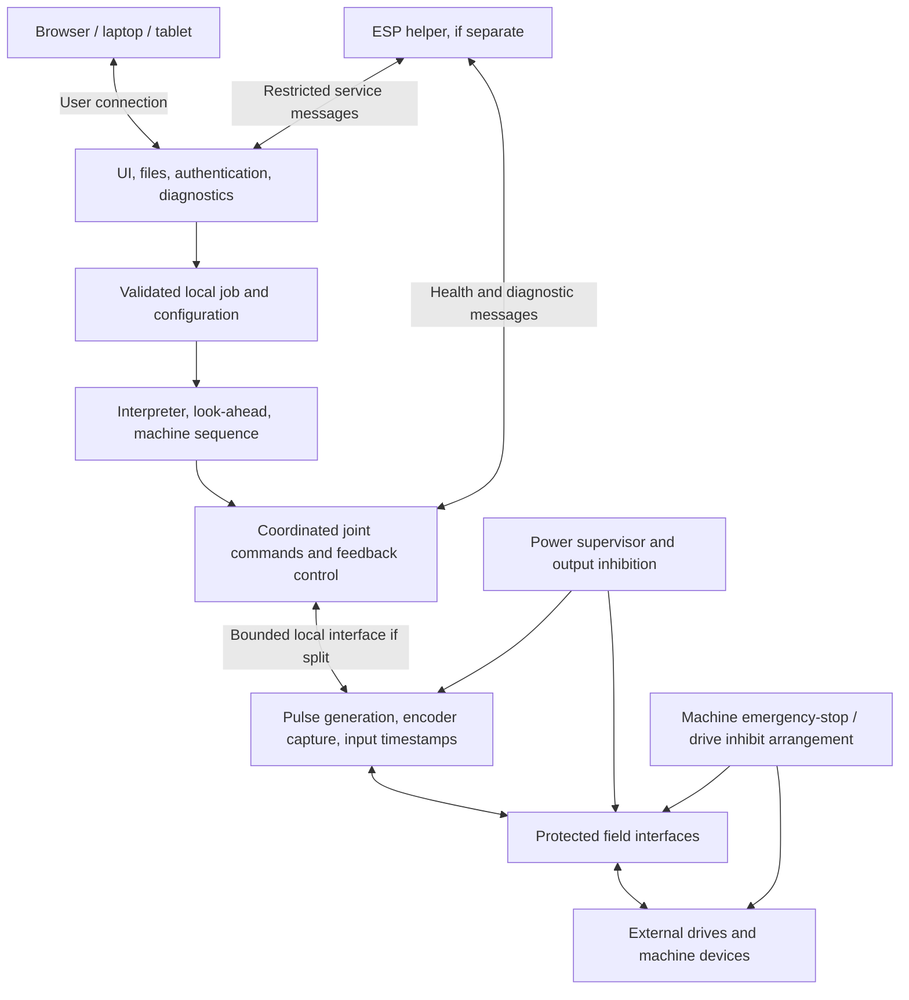
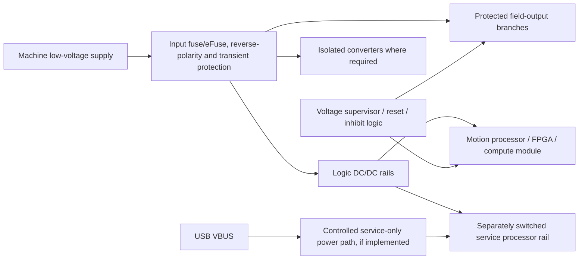

# CNC controller hardware pre-design

Status: engineering draft for work before ordering; 27 September 2026. No component, machine capacity, pin assignment, schematic, or PCB has been approved. Numerical examples are design exercises, not user requirements or measured performance.

28 September update: the working software direction is local PREEMPT_RT Linux/LinuxCNC plus FPGA timing and an ESP32 service helper, with an included touchscreen. The earlier MCU alternatives and resource examples below remain comparative research. For the latest narrower scope use the [build plan](BUILD_PLAN.md), [terminal/cost worksheet](CORE_INTERFACE_COSTING.md) and [SPI feasibility audit](../research/SPI_FEASIBILITY.md); these supersede earlier generic processor-role and channel assumptions without freezing a part or schematic.

This document converts the investigation into interfaces, budgets, and decisions that can be checked before money is spent. It is intended to become the input to schematic capture and firmware board definitions. The companion [architecture decision record](ARCHITECTURE_DECISIONS.md) explains which choices remain open.

## 1. Working brief and boundaries

The intended controller is a standalone machine appliance. A normal laptop, tablet, or phone supplies the interface; the controller owns motion execution. Ethernet, USB-C, Wi-Fi, and Bluetooth are possible connections with different roles. An ESP-family processor may be the motion processor, a communications/service processor, or a recovery assistant. The user has not selected one of those roles.

The expanded user ambition is an extremely capable platform that can work with many machine types, relay/control voltages, drives, and industrial interfaces. Translate that into a **modular family of explicitly rated interfaces**. Voltage, current, AC/DC behavior, load type, isolation, timing, and connectors are properties of each module/port. There is no physical port that accepts arbitrary voltage or switches an unlimited load. The platform can control a wide variety of power systems through compatible interface modules, external relays, contactors, and drives while the logic core stays within its own low-voltage domain.

The user's phrase "real kernel level" is interpreted as a desire for direct, dependable low-level control. Whether a Linux kernel, an RTOS, bare-metal firmware, a programmable-I/O engine, or FPGA is the best implementation remains an engineering decision. PREEMPT_RT changes scheduling and interrupt behavior; it does not qualify a board or peripheral driver by itself. [Linux kernel real-time theory](https://docs.kernel.org/core-api/real-time/theory.html)

The product concept is separate from the example sizing profile. Six joints, differential step/direction, a spindle encoder, 24 V field I/O, and a 1 kHz control cycle are useful stress cases below. They are not a settled feature list. A joint is an independently driven mechanism; a gantry can require two joints for one coordinate axis.

Before final electronics, establish whether the first target is a router/mill, a lathe requiring threading, plasma with torch-height control, or another machine. Each can change the feedback, sequencing, and stop requirements substantially.

### Advanced capability map

Design the software/expansion interfaces for these capabilities without claiming that every item is implemented by the first board or one firmware candidate:

| Capability family | Hardware consequences | Software/control evidence needed before promising it |
|---|---|---|
| Mill/router with dual-drive gantry | Independent homing/capture for both joints, separate drive faults, squaring state | Joint/axis mapping, homing sequence, following-error response, coordinated fault stop |
| Multi-axis/rotary machining | More independently controlled joints and feedback channels | Kinematics, postprocessor conventions, coordinate transforms, feed semantics, singularity/limit handling |
| Lathe threading and feed/revolution | Qualified spindle feedback and index path | Phase-synchronized motion and multi-pass thread alignment over speed variation |
| Rigid tapping | Reversible spindle command/status, direction-aware feedback, sufficient runout | Synchronization through deceleration/reversal, endpoint overshoot and recovery behavior |
| Scale-based position control | High-rate encoder/absolute-scale interfaces; common sample timing | Stable loop design, tuning, backlash/compliance treatment, following error, position validity |
| Tool changer/turret | Pneumatic/hydraulic valve outputs, clamp/position/pressure inputs, spindle orientation | Explicit sequencer, timeouts, permissives, recovery from each interrupted step |
| Spindle orientation/C-axis | Encoder resolution/index or absolute feedback; drive supports needed mode | Mode handover, position control, clamp sequencing, interlocks |
| Plasma/torch-height control | Isolated arc-voltage measurement or qualified external THC, Arc OK, torch command, ohmic/floating sensors | Height loop, anti-dive behavior, cut/pierce sequencing, probe logic, fault handling |
| Legacy analog servos | Bipolar analog output and encoder input, drive-enable/fault circuits | Position/velocity loop architecture and tested tuning/latency |
| Networked servos/I/O | EtherCAT or other specifically selected industrial network interface | Compatible drive profile, synchronized updates, network state management, fault recovery |
| Advanced probing/tool measurement | Low-latency timestamped input, optional encoder latch | Repeatability/error budget, calibration, failed probe and broken-tool cases |
| Machine automation | Expandable isolated digital/analog I/O, local panel, diagnostic sensors | Bounded PLC/task execution, observable sequence states, recoverable maintenance mode |

LinuxCNC supplies useful reference implementations for spindle synchronization/rigid tapping and tool-change handshakes, and QtPlasmaC documents a plasma-specific control workflow. Those references strengthen the case for evaluating the embedded-Linux branch when the broad feature set is mandatory, but do not validate our board or grant feature parity to an MCU port. [LinuxCNC G33/G33.1](https://linuxcnc.org/docs/2.9/html/gcode/g-code.html#gcode:g33), [tool management](https://www.linuxcnc.org/docs/html/gcode/tool-compensation.html), [QtPlasmaC](https://linuxcnc.org/docs/2.9/html/plasma/qtplasmac.html)

## 2. Functional architecture independent of processor

These are responsibility blocks, not necessarily separate chips. MCU firmware can combine PLAN, CTRL, and TIMING. LinuxCNC can supply PLAN and CTRL while an FPGA supplies TIMING. The emergency-stop arrangement belongs to the complete machine and must not depend on a web server or healthy ESP application.

### Authority contract

Latest product extension: [ESP accessory automation](ESP_ACCESSORY_AUTOMATION.md) permits a future qualified ESP implementation to own named auxiliary outputs and direct readiness sensors. The existing firmware remains read-only diagnostics. Allocate each output once; essential-service loss must affect the machine's permission/fault policy. Independent freeze/power-loss behavior, bounded after-run cooling and gravity/workholding responses belong in the [whole-unit qualification plan](INDUSTRIAL_QUALIFICATION.md).

| Function | Authority | Permitted ESP/helper involvement | Must remain true after helper failure |
|---|---|---|---|
| Start, resume, jog | Active motion controller validates request against current state and permissions | Submit requests with identity and freshness | No unsolicited start; missing jog renewal expires |
| Position, offsets, kinematics | Active interpreter/control state | Display; request validated edits while allowed | No second writer silently changes motion state |
| Step edges and direction timing | One timing engine | None unless ESP is explicitly the selected motion engine | Exactly one electrical source owns a channel |
| Encoder count and spindle index | Timing/capture engine | Read diagnostic snapshots | Capture is independent of UI refresh |
| Probe trigger | Direct capture path to motion engine | Display results | A service stall cannot delay the measurement |
| Feed hold | Motion controller with valid trajectory state | Request hold; report health fault | Controlled deceleration depends on a healthy executor |
| Drive/spindle inhibit | Output-inhibit arrangement and machine interlocks | Request inhibit; observe state | Helper cannot override a latched hardware inhibit |
| Firmware update | Maintenance supervisor while disarmed | Transfer images, show progress | Updating never grants motion authority |
| Configuration commit | Motion controller validates a versioned configuration | Edit draft; transfer proposed configuration | Runtime uses one consistent approved version |
| Logs and clock/date | Service processor | Own storage, export and time synchronization | Loss of logs cannot stall pulse generation |
| Qualified supporting equipment | Main machine logic requests; one assigned accessory executor owns the output | Future fan/coolant/air/lubrication state machines with direct sensor confirmation | Required readiness expires on failure; hardware implements necessary default/failure behavior without relying on frozen firmware |

## 3. Three serious topology branches

### A. Supported motion MCU plus optional ESP service processor

The motion MCU owns interpretation, planning, machine logic, and timing. The ESP handles browser access, provisioning, diagnostics, and optional panel services. An ESP32-S3 running FluidNC is also a single-processor subcase if its feature set satisfies the machine.

Candidate MCU families include RP2350 and supported STM32H7 configurations running grblHAL. This is a starting point for firmware due diligence, not a declaration that every package or peripheral combination works. The RP2350 driver repository explicitly covers RP2040/RP2350; firmware support must be checked for the exact board, revision, and required features. [grblHAL RP driver](https://github.com/grblHAL/RP2040), [grblHAL driver catalog](https://github.com/grblHAL/drivers)

Pre-order deliverables:

- Build the chosen upstream firmware from a pinned commit with the intended feature flags.
- Produce a peripheral allocation and worst-case memory map from that build.
- Identify any new drivers: ESP link, filesystem, encoder capture, output inhibition, and recovery.
- Specify what happens when job supply stalls and whether a locally stored file removes that dependency.
- Establish the firmware's actual threading, tapping, probing, homing, and kinematics behavior with software tests/source inspection.

Best fit if supported firmware meets the machining requirements and timer/PIO/DMA resources close. Open risk: porting advanced machine features can dominate the project even when raw CPU capacity is ample.

### B. Embedded real-time Linux plus FPGA/timing processor, with ESP helper

An embedded computer runs LinuxCNC and the user service; a local FPGA or timing MCU handles pulse generation, counting, timestamps, and output watchdogs. The ESP provides diagnostics, recovery, or independent panel services. The user laptop stays outside the real-time loop.

A compute module avoids simultaneously inventing a CPU/DDR motherboard. CM5 is a candidate, not a validated real-time platform for this design. Its official datasheet describes the carrier interfaces, power requirements, and onboard Ethernet PHY; any second internal motion network needs an explicitly budgeted interface. [CM5 datasheet](https://datasheets.raspberrypi.com/cm5/cm5-datasheet.pdf)

Pre-order deliverables:

- Reproducible LinuxCNC simulation configuration for representative machine programs.
- HAL signal ownership map, chosen uspace/PREEMPT_RT path, and driver strategy.
- An internal-link timing specification and an explicit FPGA/MCU command model.
- Gateware simulation for counters, pulse timing, watchdog behavior, and register atomicity if creating a new endpoint.
- Browser control service prototype with exclusive control ownership and a defined disconnect policy.

HostMot2 offers a useful model of FPGA functions. Mesa's Ethernet driver is a specific driver/protocol contract; a custom board is not compatible merely because it uses UDP. Mesa's documented motion-link restrictions also differ from the external HMI link. [HostMot2](https://linuxcnc.org/docs/2.9/html/man/man9/hostmot2.9.html), [hm2_eth](https://linuxcnc.org/docs/2.9/html/man/man9/hm2_eth.9.html)

Best fit if LinuxCNC's machining, feedback, or kinematics capabilities are important enough to justify the added system integration. Open risk: custom gateware plus a custom real-time driver plus a new UI is three substantial projects.

### C. New ESP32-S31 or P4-based controller, optionally with a dedicated timing device

Treat this as a deliberate firmware-development branch. The chip integrates useful communications/peripherals, but firmware maturity and deterministic execution paths require separate evidence.

The reviewed ESP32-S31 datasheet exposes an Ethernet MAC with external PHY interfaces and is marked preliminary. The P4 datasheet is also preliminary and describes application, low-power, timing, USB, and Ethernet blocks. P4 wireless service needs a companion. No exact revision, package, or pin group is selected here. [S31 datasheet](https://documentation.espressif.com/esp32-s31_datasheet_en.html), [P4 datasheet](https://documentation.espressif.com/esp32-p4_datasheet_en.html), [P4 architecture](https://www.espressif.com/en/node/7617)

Pre-order deliverables:

- Freeze a mutually consistent silicon revision, datasheet, hardware guide, errata set, SDK release, and compiler.
- Compile a minimal deterministic motion backend using the required peripherals; inspect DMA/cache/flash interaction.
- Identify whether upstream CNC code already supports that target at the pinned commit or create an explicit porting work breakdown.
- Model reset states, peripheral routing conflicts, external memory dependency, and radio/flash interference.
- Decide whether dedicated timing hardware removes enough uncertainty to justify the extra device.

Best fit if integration/size/features justify owning the port and qualification. Open risk: headline capability and available silicon do not prove production CNC software support. The hardware guides are useful for drafting power/boot/interface sheets now. [S31 schematic checklist](https://docs.espressif.com/projects/esp-hardware-design-guidelines/en/latest/esp32s31/schematic-checklist.html), [P4 design guide](https://docs.espressif.com/projects/esp-hardware-design-guidelines/en/latest/esp32p4/index.html)

### Comparison that can be resolved without buying parts

| Criterion | A: supported MCU + ESP | B: embedded Linux + timing device | C: new ESP platform |
|---|---|---|---|
| Existing CNC behavior | Feature-specific source/build audit | LinuxCNC simulation and configuration audit | Porting audit often required |
| Literal real-time Linux kernel | Absent unless added; not needed for MCU timing | Present in controller enclosure | Normally absent |
| Edge timing | Timers/PIO/DMA, possibly external timing device | FPGA/timing device | MCU peripherals or external timing device |
| Browser workflow | Existing firmware/plugins or helper service | Custom/integrated Linux service | SDK networking plus CNC integration |
| Heavy encoder population | Resource feasibility must be proven | Natural FPGA design exercise | Peripheral feasibility must be proven |
| Development concentration | Board driver and feature integration | Carrier, RT platform, driver/gateware/UI | SDK/firmware port and board |
| Must prove first | Required machining functions exist | RT driver and board strategy are coherent | Target/toolchain/peripheral behavior is supported |

No numerical score is assigned until the required machine features and team constraints are known; invented scores would disguise missing information.

## 4. Illustrative six-joint resource envelope

This envelope deliberately exposes resource pressure. It is not a promised product specification.

| Resource | Example quantity | High-level purpose | Direct GPIO if implemented individually |
|---|---:|---|---:|
| STEP/DIR output channels | 6 | External step/servo drives | 12 |
| Individual drive-enable outputs | 6 | Sequencing/service isolation | 6 |
| Drive fault/status inputs | 6 | Stop and identify failed drive | 6 |
| Spindle encoder A/B/Z | 1 | Speed, index, possible synchronized motion | 3 |
| General machine inputs | 16 | Homes, limits, probe, panel, interlock status; exact allocation pending | 16 |
| General outputs | 8 | Spindle run, coolant, lube, auxiliaries; exact loads pending | 8 |
| Optional axis encoders A/B/Z | 6 | Measurement or controller feedback | 18 additional |
| Analog spindle command | 1 | Possible 0–10 V command | DAC interface plus inhibit/monitor resources |
| Communications, storage, debug, health | Pending | USB, network PHY/SPI, ESP, storage, SWD/JTAG, reset | Additional resources |

The first six rows consume **51 logical GPIOs** before communication, analog control, debug, or six axis encoders. With those six encoders it becomes 69. Differential STEP/DIR output pairs require 24 field conductors for 12 logical outputs, before enable/reference/shield contacts. Differential encoder A/B/Z requires six signal conductors per encoder plus its power/reference arrangement. A channel count is not a pin count.

Serial expansion is suitable for some slow I/O, but transfers, error detection, output defaults, and a watchdog still need design. It does not automatically replace timestamped probe capture, high-rate encoder inputs, independent gantry homing paths, or direct inhibit logic.

### RP2350 feasibility exercise

The official RP2350 specification includes 12 PIO state machines and 16 DMA channels, with package-dependent exposed GPIO. Its PIO blocks have shared instruction-memory and pin-window constraints. Count programs, instructions, FIFOs, DREQ use, DMA channels, pins, IRQs, and core time separately. [RP2350 datasheet](https://datasheets.raspberrypi.com/rp2350/rp2350-datasheet.pdf)

An intentionally conservative first allocation of one PIO state machine per step channel uses six; one per A/B decoder uses seven more when six axis encoders and one spindle encoder are fitted. That is 13, exceeding 12 before other PIO uses. This does **not** prove RP2350 cannot do the job: grouped pulse generation, alternative counting peripherals, CPU-assisted index capture, or external counters could change the allocation. It proves that "12 PIO engines" alone is not a closed design.

Keep a per-program worksheet:

| Function/program | Instances | PIO block/instructions | State machines | DMA channels and bandwidth | IRQ work | GPIO constraints | Status |
|---|---:|---|---:|---|---|---|---|
| Coordinated STEP/DIR | 6 logical channels | To derive from actual driver | TBD | TBD | TBD | Direction setup/hold; group routing | Open |
| Quadrature plus index | 1 base, 6 optional | To derive from actual decoder | TBD | TBD | TBD | Edge rate, input synchronizer | Open |
| SPI/SD storage | 1 | Hardware peripheral preferred where suitable | TBD | TBD | TBD | Pin sharing and flash conflicts | Open |
| ESP link | 1 | Hardware SPI/UART candidate | TBD | TBD | TBD | Bounded interrupt budget | Open |
| Fault capture/inhibit | System | Direct hardware plus firmware reporting | TBD | TBD | TBD | Independent of FIFO progress | Open |

### STM32H7 feasibility exercise

STM32H7 is a family, not a fixed resource set. The H743 datasheet is a useful starting example with timer, Ethernet, USB, memory, and package options; final allocation must match the actual selected SKU. Do not carry H743 resources into H723 or another device by assumption. [STM32H743 datasheet](https://www.st.com/resource/en/datasheet/stm32h743vi.pdf)

For each proposed channel, record timer instance/channel, whether encoder mode consumes a whole timer, trigger synchronization, alternate-function pin, DMA request, memory accessibility, and interrupt priority. Audit D-cache maintenance and buffers used by DMA. Confirm that an Ethernet MAC pin group, USB PHY interface, SDMMC, and debug do not collide with the intended timer pins. Six timer channels do not necessarily mean six freely routable independent synchronized step generators.

### FPGA feasibility exercise

Create parameterized blocks for N step generators, M quadrature/index channels, input timestamps, a common monotonic clock, output control, and a watchdog. Synthesize against at least one candidate FPGA family before part selection. Record LUT/flip-flop/block-RAM/PLL/I/O-bank use, timing closure, external oscillator constraints, configuration storage, and usable toolchain/license conditions. HDL simulation alone does not establish timing closure or electrical suitability.

## 5. Motion and feedback rate calculations

Use drive input specifications and mechanics to derive pulse rates:

`steps_per_mm = motor_steps_per_rev × microsteps × gearing / travel_mm_per_rev`

`step_rate_Hz = steps_per_mm × velocity_mm_per_s`

Example A: 200 motor steps/rev, 16 microsteps, 1:1 gearing, and 10 mm/rev gives 320 steps/mm. At 250 mm/s, the required pulse rate is **80 kHz per joint**.

Example B: an electronic gearing choice of 1,000 commanded steps/mm at the same speed needs **250 kHz per joint**. Six channels create 1.5 million pulse periods/s and up to 3 million STEP transitions/s. Hardware peripherals can perform these concurrently; a design that interrupts for each transition must budget all of that work.

If a particular drive requires 2.5 microseconds STEP high and 2.5 microseconds low, its maximum under those constraints is `1 / 5 us = 200 kHz`. It cannot accept Example B without changing gearing, speed, or the interface. Direction setup/hold and isolation/transceiver propagation must also be satisfied. These numbers illustrate a calculation; no drive has been selected.

For a quadrature encoder specified as 2,048 A-channel cycles/rev and operated at 6,000 rpm:

`quadrature_edges_per_s = 2048 × 4 × (6000 / 60) = 819,200`

That is 819.2 decoded transitions per 1 ms control period on average. A 1 kHz software poll cannot read each edge; dedicated counting/capture must preserve them between polls. Encoder vendor terminology varies: explicitly distinguish cycles, pulses, and decoded counts before multiplying by four.

For each encoder/scale, specify maximum frequency, minimum high/low time, phase relationship, index width, signal voltage/common-mode range, cable length, and electrical driver type. Determine whether the controller uses it only for diagnostics, for spindle synchronization, for following-error detection, or to close a position loop. Those are different software responsibilities.

## 6. Time, transport, and buffering budgets

Draft targets must be traced to machine error limits. Keep edge generation, feedback sampling, control-cycle latency, UI responsiveness, and clock synchronization as separate budgets.

| Quantity | Illustrative starting value | What must establish the actual requirement |
|---|---:|---|
| Control/servo period | 1 ms | Plant/drive dynamics, control architecture, firmware support |
| STEP rate per joint | 80–250 kHz examples | Mechanics, gearing, speed and drive pulse timing |
| Encoder edge rate | 819.2 kHz spindle example | Encoder resolution and maximum spindle speed |
| UI telemetry | 10–50 Hz display example | Human factors and browser/service capacity |
| Input timestamp resolution | Unspecified | Probe error allowance and spindle phase requirement |
| Maximum control-command age | Unspecified | Stop-distance analysis and transport implementation |
| Hardware watchdog threshold | Unspecified | Worst normal latency versus permissible fault exposure |
| Buffer low-water threshold | Unspecified | Deceleration time and planner replenishment guarantee |

A hypothetical 128-byte command and 128-byte feedback record at 1 kHz is 256 kB/s total application payload, or 2.048 Mbit/s before framing. It is a sizing example, not the proposed protocol. A low-bandwidth serial link can therefore constrain some architectures even though G-code file transfer is modest. A 20 MHz SPI link has a 2.5 MB/s raw bit-rate ceiling before overhead and firmware delays; this alone proves neither usable throughput nor deadline compliance.

For a cyclic controller, establish this inequality using measured or defensibly bounded terms:

`input capture age + read transport + scheduling jitter + control compute + write transport + output-latch delay <= allowed feedback-to-output age`

For a queued trajectory endpoint, require local start times, sequence/session identity, atomic joint updates, minimum future horizon, queue capacity, underrun behavior, and complete cancellation semantics. Acknowledgments must distinguish received, accepted, and executed. UI time and wall-clock/NTP time must never step the motion clock.

Separate oscillators drift. A relative frequency error of 100 ppm accumulates 100 microseconds of timestamp difference per second without correction. A distributed design therefore needs a common clock, synchronization mechanism, or a command model that does not depend on synchronized absolute time. A PTP-capable MAC does not by itself synchronize the application or implement a qualified servo network.

## 7. Stop behavior is a machine-level requirement

Three operations must have different definitions: normal program stop, controlled fault deceleration with a healthy motion executor, and loss of torque/motion authority when that executor cannot be trusted.

For a simplified constant-deceleration example:

`d_stop = v × t_detection + v² / (2 × a)`

At 250 mm/s, 20 ms detection, and 1,000 mm/s² deceleration: detection travel is 5 mm, braking travel 31.25 mm, total **36.25 mm**. Deceleration takes 250 ms. Jerk limits, response time, drive behavior, gravity, and mechanical compliance can increase the actual result.

A 10 ms queue does not, by itself, contain a 250 ms stop. If the planner/host disappears, an endpoint can only perform controlled deceleration if it has the necessary state and a validated local algorithm, or sufficient preplanned stop information. Merely gating STEP immediately can produce lost position or uncontrolled mechanical behavior. A torque-off input also does not actively hold a gravity-loaded axis; brakes and their sequencing belong to the machine design. [Beckhoff safe drive functions](https://www.beckhoff.com/en-gb/products/motion/twinsafe-safe-drive-technology/)

Do not call the custom controller's watchdog a certified emergency-stop system. The controller can provide operational interlocks, fault detection, and outputs to a separately engineered machine stop arrangement. Determine the needed stop behavior with the actual drives, brakes, spindle, and mechanics before an enable circuit is finalized.

## 8. Electrical interface contract

All signal names below are logical placeholders. Connector numbering, polarity, devices, tolerances, surge levels, cable limits, and isolation ratings remain to be specified.

| Interface | Proposed direction | Reset / unpowered default | Required before schematic release |
|---|---|---|---|
| STEP/DIR | Differential line-driver interface to external drives where compatible | Output inhibited, no interpreted STEP edges; DIR stable | Drive input circuit and timing; amplitude/common mode; termination; polarity |
| Drive enable | Separately controlled per drive if useful, plus machine inhibit | Drive disabled according to actual drive polarity | Drive truth table, brake dependency, fail-open behavior |
| Drive fault | Protected 24 V or differential/logic receiver matched to drive | Open/missing signal distinguishable where practical | Source/sink type, NC/NO convention, diagnostic coverage |
| Home/limit | Nominal 24 V protected field input | Uncertain/open condition handled per machine logic | PNP/NPN/contact type, debounce, dual-joint homing, cable diagnostics |
| Probe | Dedicated fast conditioned input plus timestamp path | No false valid contact during boot | Sensor voltage, normally-closed option, filter delay/error budget |
| Spindle encoder | Differential A/B/Z receiver where encoder supports it | Count invalid until interface/configuration valid | Frequency, termination, line-fault detection, isolated supply needs |
| Axis encoder/scale | Optional differential capture banks | Position untrusted on reset unless proven otherwise | Loop ownership, counter width, index/absolute protocol, simultaneous sample |
| General outputs | Protected sourcing/sinking driver selected per load | De-energized or explicitly machine-defined state | Current/inrush, inductive clamp, thermal budget, fault feedback |
| Spindle analog | Optional isolated 0–10 V stage | Command forced to zero; separate run permission inactive | VFD input impedance/reference, accuracy, scaling, isolation |
| RS-485 / CAN expansion | Optional isolated transceiver | Transmit disabled until configured | Bus ownership, protocol, termination, fault containment |
| USB-C service | Data/recovery device role proposed | Cannot energize machine outputs | USB controller/speed, CC role, ESD, backfeed prevention, grounding |
| Ethernet | HMI/job interface; internal RT network only if selected | Motion inhibited until local state valid | MAC/PHY/controller choice, magnetics, ESD, shield, topology |
| Radio | Module/antenna arrangement selected later | No motion authority from pairing/provisioning | Antenna keepout, enclosure loss, interference, pairing/authentication |

### Field input design

Do not connect nominal 24 V machine wiring to processor GPIO. Select input conditioning from the required threshold/current characteristic, isolation boundary, bandwidth, and fault tolerance. ISO1212 is one reference component class: an isolated industrial input receiver with documented input behavior. It is not selected as the BOM device here. [TI ISO1212 datasheet](https://www.ti.com/lit/gpn/iso1212)

Provide separate filtering policies for mechanical contacts and timing-critical inputs. A configurable software debounce does not replace protection against overvoltage; an RC filter adequate for a bouncing limit switch may introduce excessive probe delay. At velocity `v`, an uncertain input delay `dt` contributes `v × dt` position uncertainty. At 50 mm/s, 100 microseconds corresponds to 0.005 mm before other errors.

### Differential interfaces

Differential signaling improves noise rejection within the receiver's common-mode limits; it is not galvanic isolation. Match the driver, receiver, termination, cable impedance, bandwidth, propagation delay, and fail-safe behavior. Confirm the disconnected/shorted/idle receiver state explicitly; it must not become spurious motion or counts. TI documents why an unbiased terminated idle link can be ambiguous for a receiver lacking suitable fail-safe behavior. [TI differential fail-safe guidance](https://www.ti.com/document-viewer/lit/html/SSZT656/GUID-27C7EED1-D790-406F-8502-C05C35801E1E)

For STEP/DIR, include channel skew and isolator delay variation in minimum high/low and direction setup/hold checks. For encoders, count at the receiver output and account for filter delay and channel skew. Decide whether disconnected encoders must be detected; ordinary quadrature decoding alone cannot prove cable integrity.

## 9. Isolation and grounding domains

### Modular interface family for broad voltage and machine support

The broad-compatibility design is a low-voltage control/timing core with replaceable interface banks. Each bank declares a type and a finite rated operating envelope. Modules may be on a carrier, on keyed mezzanines, or in external DIN-rail enclosures; the physical system is still open. Isolation can be per channel or per bank depending on the application and module budget.

| Module family | Intended interface class | What the design must state explicitly |
|---|---|---|
| DI-contact | Dry-contact sensing with a defined wetting supply | Wetting voltage/current, contact resistance, debounce, open/short diagnostics; dry contact does not itself supply voltage |
| DI-DC | Industrial DC sensors, nominal 24 V example | Allowed input range, PNP/NPN/source/sink wiring, thresholds/current, reverse/overvoltage tolerance, isolation and filtering |
| DI-AC | AC status sensing in a separately rated module | RMS voltage/frequency range, insulation, threshold and response time, connection/protection arrangement |
| DO-source | Protected high-side DC outputs | Supply range, continuous/inrush current, voltage drop, short-circuit behavior, thermal derating, inductive clamp |
| DO-sink | Protected low-side DC outputs | Same ratings plus reference/current-return arrangement and off-state leakage |
| DO-contact | Isolated mechanical relay contacts | Separate coil and contact ratings, AC/DC breaking capacity, load category, inrush, lifetime, minimum load, contact spacing |
| DO-SSR-AC / DO-SSR-DC | Load-specific solid-state switching, normally outside core | AC/DC suitability, leakage, minimum load, on-state dissipation, heat sinking, zero-cross behavior where relevant |
| DRV-step | Differential STEP/DIR and enable interface, often described as 5 V differential | Actual driver amplitude and receiver compatibility, pulse timing, cable/termination, galvanic isolation if needed |
| ENC-diff | Differential incremental A/B/Z encoder/scale, common 5 V-powered class | Supply tolerance/current, receiver thresholds/common mode, edge rate, termination, cable diagnosis |
| ENC-absolute | A specifically supported absolute encoder protocol | Electrical standard, timing, framing, protocol/licensing, CRC/error handling, startup position trust |
| AI-voltage / AO-voltage | 0–10 V and/or bipolar ±10 V families | Range, accuracy/drift, impedance/load, bandwidth/settling, common mode, overvoltage behavior and isolation |
| AI-current / AO-current | 4–20 mA family | Active/passive loop role, compliance voltage, burden, loop supply, accuracy, open-loop/fault behavior |
| BUS-RS485 | Isolated serial field interface | Protocol such as Modbus if selected, baud rate, termination/bias, node count, isolation, direction control |
| BUS-CAN | Isolated CAN/CAN-FD where supported | Controller/transceiver support, bitrate/cable topology, node count, termination, protocol and timeout rules |
| BUS-EtherCAT | Networked motion and I/O ecosystem | MainDevice/SubDevice role, endpoint hardware, supported profiles, cycle budget, distributed clocks, diagnostic states |
| Plasma-sense | Dedicated isolated arc-voltage/torch-sensing interface | Qualified input source/range, division/isolation method, noise/transient environment, bandwidth and torch-system compatibility |
| Temperature/process | RTD, thermocouple, pressure or other purpose-specific input | Sensor excitation, compensation, range, calibration, wire fault detection and isolation |

The numbers in these family names are **nominal industry signal classes**, not approved specifications for the future board. A 24 V interface may be designed for a defined wider operating range, but that range must be calculated, documented, and tested. A software setting cannot increase an isolation barrier or transistor's physical rating.

Relay coil voltage and switched load voltage are separate. For example, a controller output can drive a suitably rated low-voltage coil/interface, and that relay/contactor can switch its separately rated load circuit. The contact rating must fit voltage, AC/DC, current, load type, duty, and inrush; an AC resistive rating cannot be reused as a DC motor rating. Phoenix Contact's selection guide distinguishes those load ratings. [Relay load selection guide](https://assets.phoenixcontact.com/file/e21ac3ed-f64b-47b4-a441-dad823f566f8/media/original?US_PLC-Relay-Brochure-with-Cross-Section-Spread_20220823.pdf=)

Solid-state outputs also need a typed contract. Off-state leakage and AC/DC switching mechanisms matter; "off" is not necessarily an open mechanical contact. [Omron SSR technical information](https://www.ia.omron.com/support/guide/18/further_information.html), [Omron leakage behavior](https://www.ia.omron.com/support/faq/answer/18/faq02155/)

Keep mains/high-energy switching in separately rated external devices/enclosures for the working platform concept. The control core sends low-voltage commands and receives isolated status. This allows wide load-voltage support without routing every load's voltage through one PCB. Specialized high-voltage sensing is likewise a separate module with its own engineering, not a jumper on a GPIO port.

Industrial configurable analog modules are feasible, as illustrated by TI's reference design covering voltage/current ranges with isolated control and power. Any adapted design still needs our required accuracy, reset state, load limits, and verification; the reference design's tests do not transfer automatically to a new layout. [TI TIDA-00118](https://www.ti.com/tool/TIDA-00118)

EtherCAT belongs in the candidate expansion architecture for advanced servo/I/O work. It has a defined MainDevice/SubDevice system and clock synchronization; it is not an arbitrary UDP network with an industrial connector. Custom SubDevices need appropriate endpoint hardware/implementation, while supported commercial drives may be controlled through a compatible MainDevice stack. [EtherCAT technology](https://www.ethercat.org/en/technology.html)

### Expansion/backplane contract to draft before module schematics

The later [repair and machine-memory specification](MODULAR_REPAIR_AND_MEMORY.md) adds retained wiring, a protected removable configuration cartridge and preprogrammed spares. First cost keyed pluggable terminal groups; keep a fixed wired base as a separately costed option. Treat grouped I/O and process interfaces as candidate repair boundaries, and do not require a separate FPGA daughtercard without a measured repair/cost advantage. Settings live independently of module factory calibration and executable images. Review cartridge power/bus/WP, capacity, write-failure recovery and connector errors before freezing these schematics.

- **Typed identity:** module family, hardware revision, channel count, calibration revision, firmware/ABI, and declared electrical envelope.
- **Physical incompatibility where necessary:** different keyed connectors for incompatible field classes; clear per-port labeling. Auto-detection helps software but cannot protect a connector from a wrongly applied voltage.
- **Power budget:** permitted backplane rails/current/inrush, local conversion, per-slot protection and sequencing. Field load power is separate from logic/backplane power.
- **Data budget:** cycle/latency class, timestamp source, payload maximum, arbitration, CRC, sequence/session handling, watchdog and output-default policy.
- **Timing classes:** slow PLC I/O, sampled analog, timestamped event, high-rate encoder, and synchronized drive output. Do not assume all can share the same slow service bus.
- **Fault containment:** a shorted module or hung peripheral must not starve all motion channels; bound bus waits, reset individual modules where possible, and detect removal.
- **Output permission:** local module gate obeys core inhibit and its own valid state; a reset/unconfigured slot cannot retain a previous command indefinitely.
- **Module replacement:** default to power-off replacement until hot-plug circuitry, connector sequencing, bus isolation, and system behavior are deliberately designed and validated.
- **Calibration/diagnostics:** store calibration with its hardware identity, expose channel faults, and timestamp data validity. An unknown module never inherits another module's pin functions.

The module descriptor is documentation and software configuration, not a substitute for physical ratings. A suitable draft schema is `module_id, hardware_revision, port_class, channel_count, rated_voltage_range, current_limit, ac_dc, load_class, isolation_boundary, timing_class, update_period, watchdog_action, calibration_id`; actual values must come from the module's engineering record.

Draft domains:

1. **Machine field supply and outputs:** nominal 24 V candidate, protected incoming supply, load currents and inductive transients.
2. **Controller logic:** regulated logic rails and local reference; processor, storage, debug.
3. **Service/network processor:** can share logic ground, but separate power/reset control is desirable if recovery requires it.
4. **Encoder/drive interface banks:** shared or isolated by bank according to cable/common-mode requirements.
5. **Spindle analog:** separate isolated reference when required by VFD interface.
6. **Chassis/shield/protective earth:** mechanical enclosure/cable-shield policy, distinct from casual signal-return routing.

An isolation barrier includes signal devices, power conversion, PCB clearances, connectors, mounting hardware, cable shields, and test/debug connections. A USB cable or oscilloscope ground can bridge an intended barrier. Decide and document where logic ground, field return, shield, and chassis connect. Do not claim isolation based on an optocoupler symbol while a shared supply or cable bypasses it.

## 10. Power, sequencing, and reset

Proposed power tree, pending total loads:

Rules for the first schematic draft:

- Choose one defined behavior for USB-only power: service mode or entirely self-powered data operation. Prevent backfeeding 24 V-derived rails into the laptop and prevent USB power from enabling drives.
- Select regulators from peak load, startup/inrush, radio bursts, compute load, peripherals, temperature, and conversion losses. Do not size only from average idle current.
- Ensure each partially powered interface has an acceptable state; I/O must not parasitically power a halted processor through protection diodes.
- Hold output drivers inhibited during rail ramps, reset, boot ROM, firmware update, FPGA configuration, and invalid configuration.
- Use a hardware supervisor to hold reset/inhibit through undervoltage. Brownout recovery enters disarmed state and invalidates queued commands.
- Provide accessible recovery boot controls and SWD/JTAG/UART as appropriate; no debug connector carries a hidden machine enable.
- If the ESP is expected to diagnose main-processor failure, give it separately controllable reset/power and readable fault signals. Sharing the same regulator still leaves a common failure mode.
- Power hold-up for logs is optional and must be energy-budgeted. It does not preserve machine position or sustain a controlled stop without the rest of the power/control chain.

Use a budget sheet per rail: nominal voltage, min/max voltage, idle current, peak current/duration, startup current, regulator efficiency, thermal dissipation, allowed ripple, sequence constraints, test point, and branch protection. Values remain open until topology and loads are fixed.

## 11. Clock domains and synchronization

Draw every relevant clock before PCB: motion timebase, MCU/FPGA clock, Ethernet PHY reference, radio crystal, USB clock, storage interface, and optional real-time clock. Record source, tolerance over temperature/aging, startup behavior, PLL dependency, reset relation, and loss-of-clock response.

For FPGA or mixed clock domains, specify synchronizers for single-bit status, asynchronous FIFOs for streams, and atomic snapshot/handshake mechanisms for multi-bit counts. A per-bit synchronizer is not a safe way to transfer a changing multi-bit position word. Crossing a watchdog or inhibit signal needs defined assertion/deassertion behavior.

If STEP and encoder counters are sampled together, implement a common capture event or quantify skew. For spindle synchronization, specify how index and angle timestamps reach the planner/control loop, not just how a count appears in a UI.

## 12. USB-C and Ethernet implementation choices

USB-C is useful for service access even at USB 2.0 speed. First choose device/host/dual role and required power role. Then choose CC termination/controller, VBUS detection and protection, data-line ESD, connector routing, and recovery behavior from the exact USB implementation. USB power delivery and USB4 are separate scope choices. A USB-C connector does not imply either. [USB-IF terminology](https://www.usb.org/sites/default/files/usb4_language_product_and_packaging_guidelines_final__0.pdf)

Ethernet needs a complete implementation: MAC plus PHY plus magnetics/connector, or an integrated external Ethernet controller where the MCU lacks a MAC. The S31 and P4 hardware guides and selected PHY design guide must be used together. Give high-speed RMII/RGMII/USB routes their own constraints and account for designated peripheral pins. Do not assign every peripheral freely from a advertised GPIO count.

If the Linux branch needs a dedicated internal cyclic Ethernet link and an external Ethernet HMI port, draw two physical interfaces or explicitly justify another architecture. A compute module's one native Ethernet interface cannot be independently dedicated to both without additional topology/hardware. External USB-Ethernet can be an HMI convenience; it is not assumed suitable for a hard real-time motion link.

Wireless and Bluetooth traffic terminate in the service layer. A future wireless motion link would require a separate timing/failure design and evidence; more throughput does not remove variable delay or disconnection. Multiple radios also need coexistence and antenna placement work.

## 13. Schematic hierarchy and PCB constraints to prepare now

Create schematic sheets in this order after conditional architecture selection:

| Sheet | Content | Exit evidence |
|---|---|---|
| 00_System | Domains, connectors, ownership, references | Block diagram and cross-sheet net contract agree |
| 01_Power | Input protection, conversion, sequencing, supervision | Rail/current/thermal budget; no backfeed paths |
| 02_MotionCompute | MCU/module/FPGA, clock, boot, reset, memory | Exact SKU/revision, reference-design/errata review |
| 03_TimingIO | Step/dir, capture, watchdog, enable gates | Timing diagram and reset truth table |
| 04_FieldInputs | Input banks, probe, drive faults | Threshold/filter/latency/load calculations |
| 05_FieldOutputs | Protected outputs, clamps, inhibit | Load/inrush/thermal calculations |
| 06_Feedback | Encoder receivers, capture, supplies | Frequency/common-mode/termination budget |
| 07_Spindle | Analog/digital spindle interface | VFD compatibility and reset response |
| 08_Service | ESP, USB-C, debug, local panel | Independent recovery sequence and power audit |
| 09_Network | Ethernet PHY/controller/magnetics/connector | Vendor layout constraints and MAC resource match |
| 10_Expansion | Optional bus and ID/config pins | Versioned electrical and protocol contract |

Prepare ERC/net classes before routing: voltage domains, isolation boundaries, differential impedance targets from the selected interface guides, length/skew limits, high-current widths, creepage/clearance requirements, test-point access, and antenna keepouts. Exact numerical constraints come from chosen components, voltage/environment requirements, and the PCB fabricator's stackup.

Use continuous reference planes for high-speed signals and avoid crossing reference-plane gaps. Place connector protection so surge/ESD current is diverted at entry, with short intentional paths. Keep high-current field returns away from precision analog/reference routes. Provide shield-to-chassis options based on the enclosure design. These are layout objectives; they require component-specific review and later measurement.

Connector design must prevent confusing logic-only, field-power, and motor/drive connections. Record mating connector, contact rating, wire size, cable shield arrangement, service labeling, and keyed orientation. Assign physical pins only after the ownership and electrical tables are complete.

## 14. Firmware update, recovery, and service design

The update path is part of hardware architecture because it sets storage size, boot controls, image compatibility, and output defaults.

Proposed sequence:

1. Enter a maintenance state only with motion disarmed and spindle run inactive; record the reason and active configuration ID.
2. Transfer an image to inactive storage or a validated recovery mechanism. Validate length, hardware identity, version compatibility, and integrity/authenticity before activation.
3. Keep a recoverable boot path independent of the network application. Decide whether the first implementation uses A/B images, immutable recovery, or accessible wired reflashing.
4. Reboot with physical output inhibition asserted; initialize memory, timing hardware, I/O, configuration, and clocks before declaring readiness.
5. Perform version/ABI checks between motion, helper, gateware, and persisted configuration. A mismatched pair stays disarmed.
6. Require explicit rearming; never resume a queued job solely because firmware booted successfully.

The helper must not reset the motion processor during active operation as a routine "repair." A reset request first initiates a defined fault/stop path; abrupt reset remains an exceptional hardware failure handled by output inhibition. Writing flash, rotating logs, Wi-Fi scans, camera processing, or UI work must not block critical motion work.

Define recovery observables now: reset reason, last accepted/executed command sequence, active session/configuration ID, queue occupancy, watchdog cause, supply state, output permission state, encoder validity, firmware/gateware versions, and last fault record. Do not store an indefinitely replayable "enable" bit in nonvolatile memory.

## 15. Fault analysis draft

These are operational requirements to refine, not a completed safety certification or FMEA. The remaining machine hazard analysis determines whether additional independent protective measures are necessary.

| Fault | Detection / observable | Required controller response | Common trap / remaining work |
|---|---|---|---|
| Browser or Wi-Fi disconnects | Session heartbeat/lease expires | Apply selected running-job policy; stop jog when its lease expires | Distinguish local automatic job from interactive jog |
| ESP crashes/reboots | Bounded service heartbeat, reset cause | Main controller follows configured helper-loss policy; no new enable | Helper failure must not electrically drive motion pins |
| Motion application stalls | Watchdog tied to useful progress | Inhibit authority or locally stop only if qualified executor remains | Free-running heartbeat can hide a dead planner |
| Linux/internal link stalls | Freshness and endpoint watchdog | Defined endpoint fault action; no indefinite stale velocity | Raw pulse engine may be unable to decelerate by itself |
| Queue underrun | Local horizon/low-water monitor | Initiate stop while enough state/resources remain | Reaching empty queue is too late to invent stop trajectory |
| Processor brownout | Supervisor, rail telemetry | Inhibit; invalidate queues/session; restart disarmed | Avoid phantom power through GPIO or USB |
| Field supply lost/restored | Field-voltage monitor | Mark outputs/inputs invalid; no automatic restart | Logic alive does not mean drives/brakes remained controlled |
| Encoder disconnected | Receiver diagnostics/timeout/plausibility where available | Fault if feedback required; invalidate position as appropriate | Constant count alone is ambiguous at standstill |
| Drive fault | Dedicated input/drive link | Apply coordinated machine fault response | One failed gantry joint can rack the mechanism |
| Input stuck/open/short | Diagnostics appropriate to input circuit | Do not accept impossible state; block relevant operation | NC wiring does not detect every short or common cause |
| STEP output stuck or unintended edge | Electrical design and external drive feedback where available | Inhibit through separate authority path | Firmware reading its own output bit is not independent verification |
| Spindle command stuck | Separate run permission/status and machine inhibit | Remove run permission per machine stop design | Setting analog command to zero alone is insufficient |
| Configuration corrupt/mismatched | Integrity, schema, bounds, hardware identity | Stay disarmed with actionable error | Valid checksum can still cover an unsafe wrong value |
| Storage full/corrupt | File checks, quota, job integrity | Reject/stop job supply in defined manner; preserve motion deadlines | Log writes must not block real-time thread |
| Update interrupted | Boot validation/recovery | Recovery mode with outputs inhibited | Two images alone do not prove safe rollback |
| Two motion sources enabled | Hardware ownership interlock | Impossible by normal construction; latch fault if violated | Never tie alternate controller GPIOs together |
| Watchdog/enable circuit itself fails | Design analysis and external protective system | Account for uncovered failure at machine level | A single ordinary MCU is not a redundant safety system |

## 16. ESP backup modes to retain as distinct options

| Mode | What it can realistically add | Required evidence |
|---|---|---|
| Service companion | UI, file transfer, diagnostics, temperatures, panel | Restricted messages and bounded resource use |
| Recovery assistant | Observe main failure, preserve context, wired recovery UI | Independent enough power/reset, trustworthy reset sequencing |
| Alternate stopped operating mode | Run a separate small firmware after deliberate disarmed handover | Hardware output ownership selector, complete interface coverage, rehoming/state reconstruction |
| Hot motion takeover | Continue after primary failure | Replicated control state, fault detection, synchronized trajectories/clocks, verified physical state, exclusive handover |

Hot takeover is not selected. A second copy of G-code does not replicate planner state, tool compensation, homing, spindle phase, actual position, or outputs. We can specify alternate stopped recovery now without committing to automatic continuation.

## 17. Work possible entirely before ordering

| Work package | Concrete deliverable | What it proves | What it cannot prove |
|---|---|---|---|
| Requirements and machine profiles | Versioned examples with exact features/rates | Scope and architectural fit | Real mechanical performance |
| Firmware source/build audit | Pinned repositories, reproducible builds, feature matrix | Supported code compiles and maps are coherent | Interrupt/board timing under real load |
| Host simulation | Jobs, state machine, faults, position/velocity traces | Logical sequencing and protocol behavior | Analog/electrical effects |
| Gateware/PIO model | Testbench traces and assertions | Logic, counter behavior, pulse constraints in model | FPGA timing closure/PCB signal integrity |
| Resource allocation | GPIO/peripheral/DMA/memory/CPU worksheet | Candidate can plausibly fit | Real contention unless measured/modelled accurately |
| Electrical calculations | Power, filter, driver, load and timing sheets | Components meet stated numerical assumptions | EMI, assembly defects, real cable transients |
| Schematic/PCB CAD | Reviewed source, ERC/DRC, stackup constraints | Design consistency and manufacturable geometry | Physical validation or compliance |
| Software update/recovery model | Interrupted-update and reboot scenarios | State transitions preserve motion inhibition | Boot-ROM/electrical behavior on silicon |
| Verification plan | Instrument channels, fixtures, exact pass/fail cases | First prototype has a purpose | That tests have already passed |
| Candidate BOM | Alternatives and lifecycle/availability evidence | Design can be sourced in principle | Authorization to buy or guaranteed supply |

Do not manufacture "bench verified" results from software simulation. Keep test outputs labelled model, compiled, source-audited, synthesized, or measured.

## 18. Must know before schematic commitment

1. First machine profile and minimum viable feature set: joint count, gantry behavior, threading/tapping, tool changer, plasma, kinematics.
2. Drive command/feedback interfaces, manuals, input polarity/timing, enables, fault behavior, and any brake/STO sequencing.
3. Required maximum speed, acceleration, jerk policy, gearing, pulse rate, encoder/scale rates, and acceptable position/timestamp error.
4. Whether each feedback channel closes a controller loop, supports synchronization, or only monitors position.
5. Selected topology and exact upstream firmware/OS/SDK/driver versions, including any custom port scope.
6. Actual package/module and a conflict-free pin/peripheral/DMA/interrupt/memory allocation with documented reserves.
7. Machine power source, all output loads/inrush, analog references, isolation domains, enclosure, cable lengths, and environment.
8. Output reset/boot/fault truth table, drive-enable polarity, machine stop arrangement, and position-validity policy.
9. Storage/update/recovery architecture and how main/helper/gateware/configuration compatibility is enforced.
10. USB role/power behavior, Ethernet topology, radio module/antenna placement, expansion needs, and debug access.

These are questions the project must answer, not a request to pause all work. Software models, firmware audits, resource worksheets, and uncommitted circuit options can advance in parallel.

## 19. Must exist before PCB release and before ordering

- Reviewed schematic with no unexplained ERC errors; all no-connect and power flags intentional.
- Exact part/footprint/package checks against manufacturer drawings; schematic symbol pins independently checked.
- Pinned datasheets/reference designs/errata with their dates/revisions; discrepancy log closed for chosen parts.
- Power, thermal, load, threshold, filter-delay, pulse-timing, and isolation calculations with assumptions recorded.
- Boot/reset/update/output-default truth table checked across partial-power and disconnected-cable cases.
- PCB stackup and constraint set; DRC clean or documented reviewed exceptions; antenna and enclosure fit review.
- Firmware builds for the selected board map and a bring-up image that cannot enable machine motion by default.
- Software/HDL regression results, explicit remaining hardware risks, and a staged bring-up plan.
- A justified prototype quantity and BOM alternatives, with purchasing still a separate user action.

The first order should answer known engineering questions. It should not be the first time the architecture, pin count, firmware feasibility, or stop behavior is considered.
