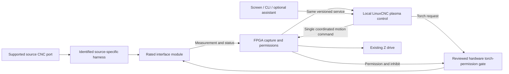

# Plasma module system — proposed platform contract

28 September 2026. **Engineering proposal; not implemented, electrically rated, commissioned, or released.** This document incorporates the user's supplied plasma/module notes. It replaces their provisional connector numbering with signal groups and explicit qualification gates. Their old citation markers are not source evidence; the manufacturer and LinuxCNC links below were checked directly.

The product objective is to change a supported plasma power source without replacing the table controller, screen, or motor wiring. A compatible replacement may need only a different identified harness and process profile; a different electrical interface requires a different rated module. The promise applies to combinations we actually qualify. It is not a universal-cutter or hot-swap claim.

Read this beside [project memory](../PROJECT_MEMORY.md), [build plan](BUILD_PLAN.md), [engineering status](../reports/ENGINEERING_STATUS.md), [electrical proposal](ELECTRICAL_DESIGN.md), and [common CLI/configuration proposal](CONFIGURATION_AND_CLI.md). No existing hardware ledger, pin allocation, software capability, or manufacturing release is changed by this document.

## 1. Three separate identities

| Record | Owns | Does not establish |
|---|---|---|
| **Interface module** | Electrical class, isolation boundary, measurement method/range/input load, supported signal types, module hardware/firmware revisions, serial number, calibration, power budget | Which cutter port is connected, an internal divider-switch position, or a valid cutting recipe |
| **Identified harness** | Exact source-side connector/key, documented contact-to-function mapping and polarity, cable construction/shielding/length envelope, adapter components, supported source variants, harness revision/identity, continuity-test evidence | A source model from connector shape alone, unverified wiring inside the cutter, or the current source settings |
| **Cutter/torch/process profile** | Power-source model/variant/options, CNC interface revision, starting technology, divider setting/evidence, torch and lead assembly, consumables, process/material/thickness, manufacturer cut-chart revision, operating parameters and qualified limits | Extra hardware ratings, evidence of physical tests, or permission to fire |

Keep these records individually versioned. A connection instance binds their exact revisions to the machine configuration and current commissioning results. A compatible cable does not make every torch or consumable supported. A module ID is an observed claim until matched to approved hardware and calibration evidence; identification memory alone is not authentication or electrical verification.

## 2. First supported package and later variants

**First engineering target: one divided-voltage module plus two independently qualified source-specific harnesses.** Prefer documented CNC ports providing divided arc voltage, transferred-arc/Arc OK, and a documented torch-start interface. Prefer non-HF-start sources for this first package. Exact cutter models and port options remain to be selected; there are currently zero qualified plasma modules or harnesses in this project.

| Proposed variant | Scope | Qualification boundary |
|---|---|---|
| `plasma.divided_voltage.v1` | Isolated measurement of a documented divided-voltage output; conditioned Arc OK; source-compatible isolated torch-start interface | Complete source/harness/module measurement chain; polarity, range, loading, common-mode/transient conditions, contact ratings and source options |
| `plasma.raw_voltage` — optional later | Separately enclosed/rated high-voltage input front end and approved installation | New protection/isolation/installation review; raw arc/electrode voltage never enters the common low-voltage expansion connector or ordinary probe/analog terminals |
| `plasma.external_thc` — optional later | Conditioned Arc OK and UP/DOWN requests from an explicitly supported external THC | Signal voltage/polarity, contradictory requests, timeout behavior, and LinuxCNC integration; no secondary STEP/DIR connection to Z |
| `plasma.digital_source` — optional later | Model-specific remote settings and diagnostics alongside the required cutting interface | Exact source, port option, protocol, isolation, firmware and failure semantics; no assumption that every RS-485 connector speaks the same protocol |

For a supported Powermax fitted with RS-485, QtPlasmaC documents remote cut mode/current/gas-pressure settings and arc-on-time reporting. This is model/option dependent, not a capability conferred by a generic cable. [LinuxCNC 2.9 Powermax communications](https://linuxcnc.org/docs/2.9/html/plasma/qtplasmac.html#plasma:pm_comms)

The two first-release harness records should become `H-A` and `H-B` qualification cases after exact parts are selected. Each needs a real cutter/port revision, authoritative connector drawing, verified wiring/continuity, measurement-chain report and powered acceptance record. Their current names are planning labels, not product IDs or claims of compatibility. The demonstration must replace source A with B using the same controller-side interface and no internal controller rewiring.

## 3. One motion authority

LinuxCNC remains responsible for coordinated motion, the plasma sequence and Z-height correction. The FPGA handles the selected timing/capture and output permissions. The module provides electrical interfacing and measurements. The ESP remains a diagnostic observer with no torch, Z-pulse, enable, or recovery authority. An external THC supplies requests to LinuxCNC; it does not independently move the Z motor.



LinuxCNC documents three plasma modes: mode 0 derives Arc OK from voltage; mode 1 combines measured voltage with external Arc OK; mode 2 uses external Arc OK and external UP/DOWN requests. Where the source supplies Arc OK, its documentation recommends using it. [QtPlasmaC modes](https://linuxcnc.org/docs/2.9/html/plasma/qtplasmac.html#plasma:modes)

The `plasmac` component exposes separate voltage, Arc OK, float/ohmic/breakaway, torch-on and UP/DOWN signals; its Z correction uses LinuxCNC external-offset interfaces. The proposed adapter must preserve those distinct meanings and units. Reusing that component underneath the preferred product UI still requires HAL/service/UI integration and tests. [LinuxCNC 2.9 plasmac reference](https://linuxcnc.org/docs/2.9/html/man/man9/plasmac.9.html)

**Current implementation gap:** the simulated CNC1 endpoint has six STEP/DIR generators and two ABZ decoders. It has no dedicated plasma frequency measurement, complete plasma input bank, torch output, module discovery, or plasma HAL driver. Its reserved bytes must remain zero under the current ABI. This proposal needs capability negotiation and an explicit new ABI allocation, RTL, driver, electrical circuits and tests; plugging a frequency source into an existing ABZ input does not implement that work. Preserve a dedicated plasma capture path in the resource study so a combination machine need not surrender its spindle encoder.

## 4. Stable signal groups, with pin numbering deferred

This is a functional connection contract. Connector series, contact count/order, current ratings, keyed variants, signal voltage levels, isolation layout, maximum cable length and exact package pins remain open design inputs. Use a keyed, locking connector that cannot reasonably be confused with ordinary Ethernet, USB, encoder, or power wiring. The project does not yet have a frozen plasma pinout.

| Controller-side group | Direction | Proposed purpose and required distinction |
|---|---|---|
| Protected module power / return | Controller to module | Declared rail, steady/startup current, branch fault indication and partial-power behavior; logic return is distinct from chassis and isolated source-side return |
| Presence / identity | Module to controller, plus configuration transactions | Physically detect incomplete connection where practicable; read module/harness records; configuration traffic cannot create torch permission |
| Primary measurement | Module to dedicated FPGA capture | Differential frequency or another separately specified interface; electrical receiver, edge bandwidth, gate interval and freshness are part of its capability record |
| Optional reference / second measurement | Module to FPGA capture | Role declared as `reference`, `second_measurement`, or `absent`; no assumption that one pair simultaneously performs both jobs |
| Arc / module status | Module to conditioned capture | Separate Arc OK, module ready and fault, each with polarity, validity and timing; ready alone does not authorize firing |
| Torch request / inhibit | Controller to module | Distinct command and permission paths; normally non-firing during boot, disconnection, update and power loss; source-side contact/output type individually rated |
| Process sensing | Field interfaces to FPGA; service observes | Float, breakaway, qualified ohmic result, optional air/source status, optional external THC UP/DOWN; channel type and ownership explicitly assigned |
| Ohmic enable, if fitted | Controller to approved sensing interface | Separate from torch request; declared behavior during probing, faults and HF exclusions |
| Chassis / shield | Installation-defined | Documented shield termination and ground/isolation boundaries; not an undocumented signal-current return |

The earlier pasted `DI8`, `DO4`, `PROCESS0` and six-pin frequency examples are conceptual assignments, not approved PCB pins or THCAD2 connector mappings. Final allocation must detect conflicts with homes, limits, encoders, mill/lathe I/O and other expansion modules. A generic 24 V sourcing output cannot substitute for a source's required isolated contact merely by renaming it.

## 5. Proposed data contract

All records require `schema_version`, immutable `id`, `revision`, content hash, units, creation/change provenance and evidence status. Unknown required features, incompatible revisions, duplicate channel owners and unspecified ratings block commissioning. Installed capabilities are the intersection of actual hardware, firmware/driver support and qualified profile evidence—not the union of requested features.

| Record | Minimum proposed fields |
|---|---|
| Module descriptor | `class_id`, `serial`, `hardware_revision`, `firmware_id` or explicit passive/no-firmware value, protocol range, required host/FPGA features, electrical-domain IDs, input range/load, isolation rating and evidence reference, measurement method, output divider, power envelope, signal capabilities, factory calibration ID/hash |
| Harness descriptor | `harness_id`, revision/serial or batch, connector/key IDs on both ends, mapping document hash, permitted source model/variant/port-option IDs, length/shielding envelope, source-side electrical classes, any series/divider/filter components, continuity/test record, identity encoding and reading status |
| Source/torch profile | Source model/serial/firmware where relevant, CNC/RS-485 option IDs, start technology, divider nominal ratio and actual-setting evidence, Arc OK/torch interface definitions, torch/head/lead geometry, consumables, permitted current/gas/mode ranges, required sensors |
| Process recipe | Source/torch profile revision, material/thickness, cut-chart reference/revision, units, current/gas/mode, cut speed, kerf, pierce/cut heights and delays, THC strategy/target and qualified bounds; distinguish remotely set parameters from operator-set values |
| Measurement chain | Module/harness/source/divider revisions, front-end range/input impedance, effective division ratio/model, zero/full-scale or multipoint calibration, frequency-output divider, capture clock/gate/filter settings, uncertainty/range/temperature envelope, calibration date and verification-due criteria |
| Commissioning record | Machine/configuration/connection epoch, bound record hashes, observed vs operator-confirmed vs measured facts, input polarity/continuity results, measurement evidence, probe/float/torch-offset registration, cut qualification, unresolved failures and authorizer |
| Runtime sample | Connection/boot epoch, acquisition sequence, capture timestamp and host receipt time, measurement interval/units, value and quality, saturation/edge-timeout flags, calibration/chain ID, Arc OK/raw sensor state plus validity, module fault/presence |
| Runtime authorization | Active machine/setup/profile hashes, one owner, connection epoch, arm/recovery state, permitted operation, expiration/cancellation reason; no persistent “always enable” setting |

Module calibration and complete-chain calibration are different records. A factory sticker or EEPROM can remain valid while the source/harness combination changes. Store provenance for a manually entered divider position; do not label it automatically detected. An identity checksum checks accidental corruption, not that the cable was assembled correctly. A source port without electronic identity requires explicit model/option confirmation and its approved harness evidence.

For a passive harness, an EEPROM/tag is one possible identification implementation. Its electrical bus, write protection, encoding and anti-misidentification policy remain design decisions. Missing or unknown ID enters a disarmed diagnostic workflow; a developer can define a new supported harness through the normal review/qualification path, not through a global bypass.

## 6. Voltage measurement is a chain

Mesa specifies THCAD2 differential frequency output, selectable 5/10 V ranges and an approximately 100 kHz–1 MHz undivided output. Its output division and calibration must be recorded. The manual warns that measuring a single undivided output period is inaccurate; use a validated counting/averaging method. A THCAD2-class reference does not qualify our replacement circuit. [Mesa THCAD2 manual, printed pages 2–3 and 7–8](https://www.mesanet.com/pdf/analog/thcad2man.pdf#page=4)

Mesa's loading example is a nominal 50:1 source divider with 6 kΩ output resistance feeding the THCAD2's 100 kΩ input: the effective ratio is `50 × (100k + 6k) / 100k = 53:1`. Thus a nominal menu selection alone can produce the wrong displayed arc voltage. [THCAD2 external dividers, printed page 7](https://www.mesanet.com/pdf/analog/thcad2man.pdf#page=9)

**Proposed calculation contract:** normalize the measured frequency to the calibration's frequency basis first; apply the module's measured offset/gain or calibration curve; then apply the verified complete-chain division model. Include source output resistance, protection/series components, module input load and any relevant cable/filter effects. For a linear chain, the records can express:

```text
module_voltage = calibrated_conversion(measured_frequency, frequency_divider)
arc_voltage    = module_voltage × effective_chain_ratio
```

The simple ratio calculation is appropriate only for the documented equivalent circuit. Do not apply the 53:1 example to every “50:1” source, add the same load correction twice, or assume an undocumented/active divider is resistive. The engineering verification report must identify what was measured, the approved source condition/procedure, instrument and uncertainty, physical connections, and whether the source's documented nominal ratio already assumes a load. This document does not prescribe live raw-arc probing.

The proposed measurement gate should require calibration evidence covering the fitted range and intended operating region, checked polarity and no clipping, repeatability, and a recorded latency/noise/uncertainty budget. Gate time and filtering trade measurement resolution against delay; they belong in the versioned process qualification, not an arbitrary GUI smoothing setting. The FPGA acquisition timestamp must describe when a sample was captured, not when a browser eventually received it.

THCAD2's manual warns about hazardous input-side voltages and inadvertent loss of isolation. Keep the source-side circuit physically segregated; isolation must survive the full installed cable/ground arrangement. [THCAD2 warning, PDF page 2](https://www.mesanet.com/pdf/analog/thcad2man.pdf#page=2)

HF-start is a separate electrical/EMC qualification, not a software checkbox. QtPlasmaC specifically advises against ohmic sensing with HF-start supplies. The first proposed profile family therefore rejects HF-start/ohmic combinations; any later exception needs a separately reviewed sensing/interface design and evidence. [QtPlasmaC THCAD cautions](https://linuxcnc.org/docs/2.9/html/plasma/qtplasmac.html#plasma:mesa-thcad)

## 7. Power-off swap and selective invalidation

The supported procedure is **power-off replacement**, following the selected source's shutdown/discharge and installation instructions. Presence detection adds fault detection; it does not make live insertion/removal supported. All commissioning stages start with the torch request cleared and the hardware permission withheld.

1. Save the active configuration/record revisions and end the job. Enter the defined stopped maintenance state. Power down the relevant equipment before disconnecting.
2. Fit the approved module/harness/source combination, then restart into a new connection epoch with torch permission off. Read identities/capabilities and display what is detected, what is merely selected, and what remains unverified.
3. Build a dependency diff. Preserve only unaffected configuration and calibration records. Stored axis scale/travel and machine geometry may survive if their hardware/firmware dependencies are unchanged. This does not preserve live homing after power loss or prove that a saved workpiece registration remains physically true.
4. Validate compatibility and allocate resources. Confirm source/port option and divider setting; reject missing evidence, unknown polarity/range or unsupported capability. Re-home under the machine profile where required.
5. Run guided non-firing checks and affected registration/calibration steps. Verify sensor states, probe/float operation, measurement chain and torch offsets using the approved procedures. Revalidate jobs/recipes against the new source/torch combination.
6. After the applicable commissioning prerequisites pass, offer a separate scoped operator-authorized firing/cut qualification procedure. This operation produces the pending process-qualification evidence under the restricted commissioning contract below; it is not normal production cutting. Detection, configuration import, test selection, power restoration and reconnection never issue a torch pulse themselves.

| Changed dependency | Retain when unaffected | Invalidate/recheck before use |
|---|---|---|
| Power source or CNC-port option | Controller identity, screen settings, unchanged motor/axis configuration | Interface compatibility, divider/Arc OK/start semantics, voltage chain, process recipes and source-specific cut qualification |
| Harness/revision/adapter components | Unchanged table mechanics | Mapping/identity/continuity, voltage loading/polarity, source-side ratings and affected chain evidence |
| Measurement module/range/output-divider/firmware | Unchanged axis scaling and torch geometry | Capture/scaling/freshness and chain calibration; protocol/feature compatibility |
| Torch, consumable stack, lead or mounting position | Unchanged controller/table calibration | Torch/probe/float offsets, Z reference, affected XY tool offsets, height recipe, consumable/process compatibility and affected job registration |
| Stock position, bed/slats or fixture | Unchanged encoder/motor scale | Affected material/fixture/XY/Z registration and clearance/job checks |
| Axis mechanics, drive timing, encoder, steps/unit or kinematics | Only independent records | Dependent machine calibration, homing/limits, registration and motion qualification |
| Full power cycle or lost position | Valid stored calibration values | Live homing/position confidence and any registration that depended on it; never automatic job resumption |

A saved recipe may remain in the library while being marked `not_valid_for_active_setup`. Rollback restores configuration data, not a claim that a removed torch, old workpiece or former wiring is still physically present.

## 8. Compatibility and setup gates

Every gate returns a stable error code, affected record IDs and an actionable next step through the same UI/API/CLI contract. These are proposed product checks, not currently implemented `cncctl` commands.

The table describes normal-run permission. **Initial cut qualification is a separate restricted commissioning operation:** require valid identity, electrical compatibility, measurement calibration, required sensors, registration, independent stop/inhibit checks and a reviewed bounded test plan within the source's documented limits. Permit only the specific pending process-qualification evidence to be generated by that test. Its authorization names the test, setup revision, limits and expiration; it cannot authorize general jobs or bypass other failed gates. A successful observed test creates a reviewable evidence record before normal-run permission becomes available. This avoids requiring a previously completed cut test in order to perform the first one.

| Gate | Pass requirement | Example blocking result |
|---|---|---|
| Identity | Known module and harness, supported source option, matching revisions and evidence | `PLASMA_HARNESS_UNKNOWN` |
| Electrical | Correct ranges/output types/isolation domains, compatible power budget and reviewed pin mapping | `PLASMA_INTERFACE_MISMATCH` |
| Resources | Required capture/I/O/HAL features implemented and exclusively allocated | `PLASMA_CAPTURE_UNAVAILABLE` |
| Measurement | Valid chain/range/divider setting/calibration and timestamp/quality path | `PLASMA_CHAIN_UNVERIFIED` |
| Sensors | Required float/breakaway/Arc OK/other status valid, correct polarity and plausible baseline | `PLASMA_SENSOR_STATE_INVALID` |
| Registration | Current dependencies for homing, torch offsets, material location and clearances | `PLASMA_REGISTRATION_STALE` |
| Process | Source/torch/consumable/material recipe qualified within actual limits | `PLASMA_PROCESS_UNQUALIFIED` |
| Authorization | New explicit operation scoped to current epoch/setup; no pending old request | `PLASMA_REARM_REQUIRED` |

Proposed discovery output should include `supported_modes`, `electrical_class`, `capture_method`, `measurement_valid`, `measurement_age_us`, `chain_id`, `module_present`, `arc_ok_valid`, `torch_request`, `torch_permission`, `active_setup_revision` and `blocking_checks`. Report request and permission separately; neither is proof of arc output. Where torch-active feedback exists, publish it with its own source/validity.

Suggested CLI families extend the existing proposal: `module inspect`, `plasma compatibility`, `plasma setup plan/validate/diff/apply`, `plasma measurement inspect`, and `plasma commission`. Inspection and planning are read-only. Applying configuration requires the stopped state and invalidates dependencies atomically. A torch test is a separate, explicit operation with a short-lived authorization bound to the current setup. There is no “AI auto-fire”, persistent override, or API that marks an unperformed physical test passed.

## 9. Freshness, faults and recovery

**Proposed invariant:** torch output requires the active LinuxCNC operation, the reviewed hardware permission chain, compatible/commissioned records, and valid required signals for the selected mode. The physical output is non-firing by default. Neither a healthy browser, an ID EEPROM, nor the ESP heartbeat can maintain permission.

State progression is `DISCONNECTED -> IDENTIFIED_DISARMED -> SETUP_REQUIRED -> VERIFIED_DISARMED -> ARMED_FOR_OPERATION`. A fault returns to a latched disarmed state and cancels pending firing requests. A successful reconnection or cleared fault ends at a disarmed state; it does not return to the interrupted cut. The names define required behavior; no such product state machine is implemented here.

| Condition | Required proposed behavior |
|---|---|
| Module/harness presence lost, power lost, descriptor changes mid-operation | Withdraw torch permission via the reviewed fault path, latch fault, discard connection epoch and stop normal cutting |
| Invalid calibration/range or incompatible firmware | Prevent arming; if validity is lost during operation, withdraw permission and enter the defined abort path |
| Stale capture timestamp/sequence, edge timeout, acquisition fault or saturated measurement | Mark voltage invalid rather than zero or “last good”; inhibit further THC corrections from it and stop normal cutting for voltage-dependent modes |
| Arc OK missing at start or lost during cut | Follow bounded profile-specific start/loss detection and fault handling; do not silently change to voltage-derived Arc OK or an ignore-Arc-OK mode |
| External THC UP and DOWN both asserted, unsupported polarity or required status lost | Reject the contradictory/invalid request and invoke the qualified fault response; never create a second Z pulse stream |
| Float/breakaway/required-air/source fault inconsistent with process state | Apply the explicit profile interlock/fault behavior; record raw/filtered state and timing for diagnosis |
| Required source-setting communication lost | Stop normal cutting and require reconciliation of actual settings; optional read-only telemetry loss may be advisory only if the qualified profile explicitly allows it |
| Host/FPGA link failure or clock/configuration failure | Local output defaults and independent hardware watchdog/inhibit enforce the reviewed response; no ESP takeover |
| Reconnection, power return, software restart or configuration rollback | Cancel stale retries, queued pulses and old operation authorization; require a new deliberate arm/start after checks |

The rearm implementation must prove the torch command is deasserted before restoring its permission latch. A LinuxCNC modal command left high across reconnect must not cause immediate firing when a gate reopens. A new operation is bound to the new epoch and setup; accepting the same old held level is insufficient. Any deliberate bounded arc-start retry belongs to an already authorized, unchanged operation, and is cancelled on these faults/reconnects.

Define acquisition period, maximum sample age, edge-loss timeout, filter delay, status-input qualification delay, fault-to-torch-off time and total machine response in the qualified profile/evidence. There is no universal timeout here. A static valid arc voltage can produce an unchanging frequency: absence of value changes alone is not a failure. Conversely, a stuck but plausible oscillator may evade simple edge-presence tests. Use capture sequence/time, module diagnostics, reference/test facilities where provided, and validated plausibility checks; publish what faults remain undetectable. Repeated delivery of an old sample cannot refresh its acquisition age.

If LinuxCNC is healthy, the designed fault sequence may include a controlled motion stop while removing the torch command; loss of the motion controller can require immediate permission removal. A timed software feed hold is not a guarantee of controlled deceleration under every fault. Machine-specific response distances, torch behavior and stored-energy consequences require physical qualification. None of these proposed controls is claimed to be safety-rated, E-stop/STO, SIL or PL compliant.

## 10. Acceptance plan and release evidence

All cases below are **required future evidence**, not passed tests. Separate schema/model tests, LinuxCNC simulation, RTL simulation/synthesis, circuit ERC/board DRC, calibrated bench measurements, EMC/fault tests and physical cutting results. A green schema check cannot replace a voltage or source-compatibility measurement.

| Case | Required acceptance result |
|---|---|
| A-to-B supported swap | Power-off change between the two qualified cutters/harnesses; same controller and motor wiring; guided discovery/diff/setup through UI and CLI; no hand-edited internal configuration |
| Selective preservation | Unchanged axis/table calibration retained; affected chain/torch/process registration invalidated; live homing re-established as required; old job authorization rejected |
| Wrong or unidentified harness | No arm/fire; precise error and wiring evidence requirement; physical keyed connection and software check both evaluated |
| Wrong divider/range | A “50:1” selection without setting/chain evidence is blocked; loaded measurement and stored scaling agree within the declared uncertainty over the qualified range |
| Polarity/open/short/overrange | Faults detected where promised; no misleading valid-zero or stale-last-good value; output response measured |
| Sampling failures | Replayed samples, frozen sequence/time, missing frequency, saturation and capture-clock faults injected; stale data cannot drive THC indefinitely |
| Contradictory external THC | UP+DOWN and invalid status injected; no uncontrolled Z motion or dual pulse ownership |
| Source/Arc OK failure | Failed strike, late/lost Arc OK and required communication loss tested; bounded behavior matches the profile and records |
| Unexpected disconnect/reconnect | Accidental loss tested under an approved bench procedure; torch output drops as specified; replug/power return never fires or resumes automatically, including an old held-high request |
| Host/UI/ESP behavior | UI closure or optional AI loss does not acquire motion authority; host/FPGA faults follow their measured response; ESP cannot start torch or service motion permission |
| Power/reset/update | All rail orders, reset, unconfigured FPGA, module update and partial power tested against no-fire defaults and backfeed limits |
| Registration changes | Torch/head/lead/consumable or stock movement invalidates the correct checks without erasing unrelated machine history |
| Noise/HF boundary | Approved non-HF setups meet the EMC/false-edge plan; HF-start is rejected unless a separately qualified variant and sensing arrangement exists |
| Novice workflow | Representative users complete supported wiring/setup with correct labels and actionable diagnostics; no software inference is presented as a physical observation |

For each supported combination, retain the exact source/torch/module/harness revisions, drawings and electrical specification, calibration/uncertainty records, FPGA/driver/software versions and hashes, timing/fault/EMC results, machine setup/registration, cut-test procedure/results, and limitations. Factory tests and the customer commissioning procedure must use these same versioned capability records.

Next design work is to select the two exact source/port configurations, size the module and dedicated capture resources, define the low-voltage connector/isolation/protection and torch-permission circuit, extend the software/FPGA ABI deliberately, and cost the complete fitted option. This document supplies the contract for that work; it does not authorize an order, manufacturing submission, live connection, or firing test.
